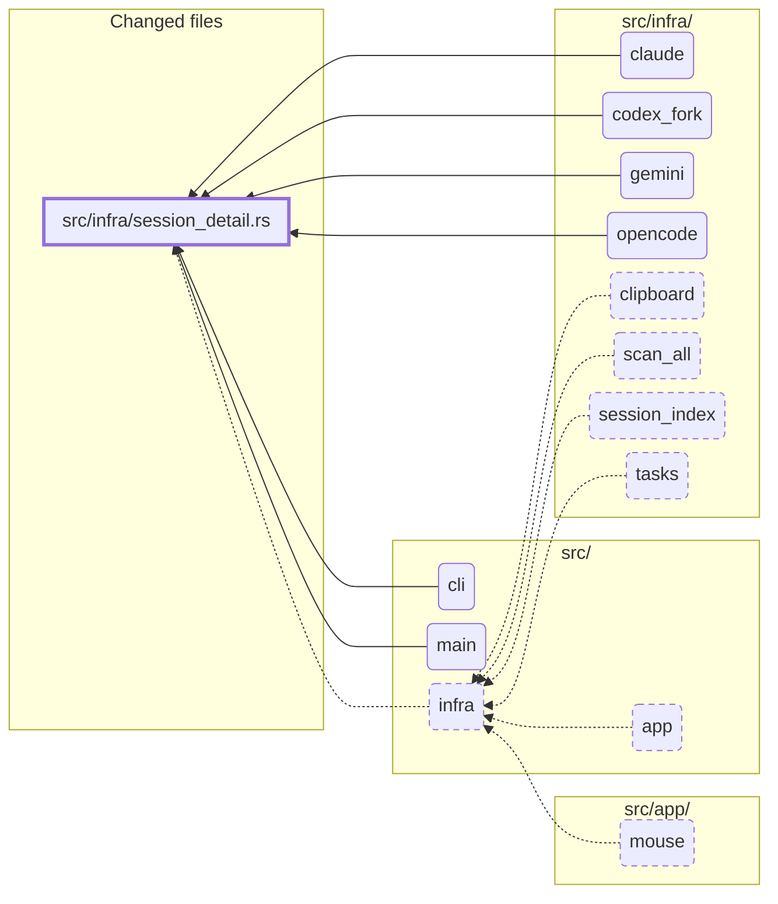

# Wingbox Pull Request Check

See what your pull request touches before you merge.

On every pull request this GitHub Action writes one comment that answers:
which modules use the files you changed, but are not part of the pull request?
Those are the places a change can break without showing up in the diff. The
comment says it in its first line:

> **Wingbox: 2 items touched by this change are used by 4 modules outside this pull request**
>
> `load_session_timeline` (function, `src/infra/session_detail.rs:97`) calls
> `detect_log_format`, which calls `looks_like_claude_jsonl`, which changed.
> These modules use it and are not in the pull request:
>
> - `src/cli` calls it at `src/cli/mod.rs:331` and in 1 more place
> - `src/infra/opencode` calls it at `src/infra/opencode.rs:992`
> - ...

You get:

- **What changed, and who uses it**: the comment names the function or type
  that holds the changed lines and the modules outside the pull request that
  use it, each with the place (`src/cli` calls it at `src/cli/mod.rs:331`). A
  changed private helper is reported through the public functions that call
  it. When what changed is not used outside the pull request (a comment, a
  test, a private item nobody calls), the comment is one sentence.
- **The tests to run**: the test files that use what changed, by name. And
  when a test changes together with the code it tests, the comment says so.
- **A review plan for an agent**: the same facts as S-expression lines, in
  the order to check, each with a file and a line. A reviewing agent goes
  through the list instead of searching the repository.
- **A strict result**: PASS, FAIL, UNKNOWN or NOT_APPLICABLE as an output of
  the action. A part that was not checked is UNKNOWN, never PASS.
- **Boundary findings first**: the layer, capability and pattern violations the
  pull request introduces (the ones the base branch does not have) lead the
  comment and its heading.
- **A picture and the rest, folded**: the blast radius as a diagram, the
  modules farther away, the tests and the files outside the code graph sit
  under one "More" line, so the comment stays short.
- **What was not checked**, said as such, so that silence is never read as a
  pass.

The comment is updated on each push, so a pull request never gets a second
one. The same report goes to the job summary of the workflow run, unfolded and
with every module listed. A pull request that changes no source file outside
the tests gets no comment; the job summary says so in one line.

The action uses [Wingbox](https://github.com/aileron-tech/wingbox), an
open-source code graph that is built on the runner, and installs
wingbox 0.14.0 from PyPI.

## What the comment looks like

The picture for a one-file change in a public Rust project (the whole comment:
[examples/rust-small.md](examples/rust-small.md)):



and the comment opens with what changed and who uses it (the commit changes
one private function, `looks_like_claude_jsonl`):

> ## Wingbox: 2 items touched by this change are used by 4 modules outside this pull request
>
> `load_session_timeline` (function, `src/infra/session_detail.rs:97`) calls `detect_log_format`, which calls `looks_like_claude_jsonl`, which changed. These modules use it and are not in the pull request:
>
> - `src/cli` calls it at `src/cli/mod.rs:331` and in 1 more place
> - `src/infra/codex_fork` calls it at `src/infra/codex_fork.rs:375` and in 1 more place
> - `src/infra/opencode` calls it at `src/infra/opencode.rs:992`
> - `src/main` calls it at `src/main.rs:426` and in 4 more places

The picture is folded under the line "More: the picture, 2 modules that use the
changed files but not what changed, 1 through a facade or declaration, 6 within
2 hops".

More examples, each the text the action would post, built locally and not
posted anywhere: [a larger change in the same Rust project](examples/rust-large.md)
and [fastapi/fastapi#16746](examples/fastapi-16746.md), a Python pull request
with several hundred dependents, where the diagram collapses folders into
counted boxes.

## Usage

```yaml
name: wingbox
on: pull_request
permissions: {contents: read, pull-requests: write}
jobs:
  check:
    runs-on: ubuntu-latest
    steps:
      - uses: actions/checkout@v4
        with: {fetch-depth: 0}
      - uses: aileron-tech/wingbox-action@v1
```

`fetch-depth: 0` is needed: the action compares the head of the pull request
with its base, so the base commit must be in the checkout.

The action installs Wingbox with the parser of every language
(`wingbox[all]`). It reads the repository and never runs it: every Python it
starts leaves the checkout off its module search path.

The action is a composite action (Python and git, no container), and its test
workflow runs it on `ubuntu-latest`, `macos-latest` and `windows-latest`.
Wingbox parses Python, TypeScript, Rust, C#, Java, Go, Ruby, PHP, Dart and
Free Pascal.

## Before a commit: check a working directory

The same check runs by hand on the files as they are on disk, so an agent (or
you) can read the plan before the commit and before a review:

```bash
python wingbox_pr.py --root /path/to/repository --base main --out /tmp/wingbox-out
```

With `--base` and no `--head` the change is the merge base of `--base` and
`HEAD` against the working directory: uncommitted edits and untracked files
included, git's ignore rules respected. Nothing is committed and the index is
left alone; Wingbox writes its graph into `.wingbox/` of the repository as it
always does. `--out` receives `wingbox-report.md` and `wingbox-plan.sexp`; the
result line is printed. It needs `wingbox` installed in the Python that runs
the script. `--head REF` checks a commit instead.

## Reading the comment

- **The heading and the first sentence** say how many modules outside the pull
  request use what it changes, and name the changed files they use. With new
  boundary findings the heading names them first. When no module outside the
  pull request uses a changed file directly and there is no new finding, the
  comment is one sentence.
- **New boundary findings**: findings of `wingbox boundaries` on the head that
  the base does not have. Known findings (in a baseline) and type-only imports
  are not counted. Without any, the comment says "No new boundary finding."
- **A changed item and its users**: the changed lines of the diff are sorted
  into the items Wingbox lists for the file (functions, types, constants).
  For each item that holds a changed line of code the comment names the
  modules outside the pull request that use it, how (calls, imports, uses as
  a type) and where. "X calls Y, which changed" means the change is in Y and
  X, which other modules use, calls it inside the same file. Comments, blank
  lines and the tests kept in a Rust file (`#[cfg(test)]`) change no item.
- **Tests that use what changed**: the test files that use a changed item
  (or, for a file taken as a whole, the file). The comment names five and
  counts the rest; the job summary names all.
- **Tests changed together with the code they test**: a changed test file
  that uses a changed source file directly and loses or replaces a line of
  code in the same pull request. New tests (lines only added) are not
  flagged.
- **A changed method**: inside a class, the changed line belongs to the method
  that holds it, named `Class.method`. Its users are the modules that use the
  class and call a method of that name; a module that uses the class but not
  the method is counted under "More", not listed. A change of a field or of
  the constructor is a change of the class.
- **Other code changed too**: lines outside every listed item (an import, a
  Rust `impl` block, a statement at the top level) cannot be given to an
  item, so the modules that use the file are listed as a whole.
- **The list of a file**: modules that import or use a changed file and are not changed
  themselves. Where Wingbox follows a name to the file that defines it, the
  row says which names (at most three, then a count). Wingbox 0.10.1 does
  this for Rust; for the other languages the row names the module (and the
  changed file, when the pull request changes several).
- **More** (folded in the comment, open in the job summary):
  - the diagram;
  - **through a module facade or declaration**: modules that reach a changed
    file only through the file that declares or re-exports it (`mod.rs`,
    `lib.rs`, `__init__.py`, an `index.ts`) without naming an item of it.
    They see the change only if it alters something they use, so they are
    counted, not listed;
  - **within N hops**: modules that depend on a direct dependent, counted by
    folder;
  - **tests** that use the changed code, counted apart;
  - the changed files that are not in the code graph.
- **Not checked**: the parts of the repository `wingbox boundaries` could not
  check (rules it cannot read, no layered style, too few files). No finding
  there is not a pass, and the comment says so.

### The review plan

The comment carries a folded block "Review plan for an agent", and the action
writes the same plan to a file (output `plan`). It is a list of S-expression
lines in the order to check:

```lisp
(review-plan :schema 1 :result UNKNOWN :execution ok :base <sha> :head <sha> :wingbox "0.14.0" :hops 2 :checked <sha> :tree merge)
(reason "not-checked: . (no-layer-style)")
(changed-item "src/billing/invoice.py" total :kind fn :line 12 :how changed)
(look "src/api/orders.py" 40 :module src/api/orders :why call :item total :places 2)
(run-test "tests/test_invoice.py" :uses total :evidence passed :cases 4)
(test-case "tests/test_invoice.py" "tests.test_invoice" "test_total" :status passed)
(test-report "test-results/junit.xml" :sha256 <digest> :cases 212)
(test-changed "tests/test_invoice.py" :tests "src/billing/invoice.py")
(not-checked "." :reason no-layer-style)
(changed-file "src/billing/invoice.py" :sha256 <digest> :commit <sha>)
```

`look` is a place outside the pull request that uses a changed item: open it.
`look-module` is a module that uses a file whose other code changed.
`run-test` is a test that uses what changed, and `test-case` a case the test
reports hold of it. `changed-item ... :how calls
:via (a b)` means the item calls `a`, which calls `b`, which changed.
`changed-file` gives the SHA-256 of the file in the commit that was checked,
what `git show <commit>:<path> | sha256sum` prints, so a reader can check that
it looks at the same content. To hand the plan to a reviewing
agent in the same job:

```yaml
      - uses: aileron-tech/wingbox-action@v1
        id: wingbox
      - run: cat "${{ steps.wingbox.outputs.plan }}"   # or pass the path to your review step
```

### The result

The action sets the outputs `result`, `execution` and `reasons`:

| result | when |
|---|---|
| `FAIL` | the pull request introduces a layer, capability or pattern violation |
| `UNKNOWN` | a part of the repository was not checked; a wingbox command ended abnormally (`execution` is then `error`); files of a language were left out because its parser is not installed; or the files checked are not the commit the report names |
| `NOT_APPLICABLE` | no source file outside the tests changed |
| `PASS` | none of the above |

`fail-on: strict` fails the job on `FAIL` and on `UNKNOWN`. The result is
about the boundary rules; the list of who uses what changed is information for
the reviewer and never fails a job.

### Which commit was checked

The graph is built from the files of the checkout, so the report says which
commit these files are (`:checked` in the plan) and how it relates to the head
of the pull request (`:tree`):

| tree | the checkout is |
|---|---|
| `head` | the head commit itself |
| `merge` | the merge of the head into the base: what `actions/checkout` gives on `pull_request`, and what would land |
| `other` | another commit: the result is `UNKNOWN` |

Before it builds the graph the action compares the checkout with that commit.
A tracked file that was changed, or an untracked source file, is named
(`tree-differs`) and makes the result `UNKNOWN`: the report would describe
files that are in no commit. Files git ignores, `.wingbox/` and files that are
not source (a test report, a build log) do not count. To check exactly the
head commit, check it out:

```yaml
      - uses: actions/checkout@v4
        with:
          fetch-depth: 0
          ref: ${{ github.event.pull_request.head.sha }}
```

### Evidence that the tests ran

The check names the tests that use what changed; it never runs them. When
the job runs its tests before the check and they write JUnit XML reports,
hand these over:

```yaml
      - run: python -P -m pytest --junitxml=test-results/junit.xml
      - uses: aileron-tech/wingbox-action@v1
        with:
          test-results: test-results/*.xml
          require-tests: true     # optional: fail unless every test that uses what changed has a passed record
```

Each `run-test` line of the plan then says what the reports hold about that
test, with the number of recorded cases:

| evidence | the cases recorded for the test |
|---|---|
| `passed` | every one passed |
| `failed` | one failed |
| `partial` | one passed, and another was skipped or did not run; the line counts them (`:passed 3 :skipped 1`) |
| `skipped` | none passed |
| `no-record` | the reports hold none |

Every case is a `test-case` line: the test, where the report puts the case
(its class name, else its file, else its suite), its name and its status.
Each report file is named with its SHA-256 (`test-report`). The comment counts
the tests: "Tests that use what changed (5): 3 passed, 1 with a case skipped
or not run (`tests/test_auth.py`: 1 of 2 cases passed), 1 without a record in
the test report". Only `passed` counts as passed, in the comment, in the
outputs and for `require-tests`. Without `test-results` every line says
`:evidence none`.

A test is matched with the cases of its file: by the file a report names, by
the dotted class name of a Python test, by the end of a Java or C# class
name. A Go report names a package and a test function, never a file, so the
action asks Wingbox for the functions of each Go test file: a record goes to
the file that holds its function (a subtest `TestX/name` goes with `TestX`),
and a `Test...` function of the file that no report names is a case
`no-record`. A report that declares a document type, or is not a JUnit
report, is refused and named. `require-tests` is separate from `fail-on`: it
does not change the result of the boundary check.

### The evidence record

Each run also writes `wingbox-evidence.json` (output `evidence`; in GitLab in
`wingbox-out/`): one JSON document for a system that keeps evidence of change
control. It holds the repository and the run, the base, the head, the commit
that was checked, the result with its reasons, the counts, the changed files
with their SHA-256, the tests to run with their evidence and every recorded
case, the test reports, and the SHA-256 of the report and of the plan written
beside it. Its shape is
[`schema/wingbox-evidence-2.schema.json`](schema/wingbox-evidence-2.schema.json)
(`"schema": "wingbox-evidence/2"`); a record of 1.4 says `wingbox-evidence/1`
and follows [`schema/wingbox-evidence-1.schema.json`](schema/wingbox-evidence-1.schema.json).

[`examples/evidence-handover.yml`](examples/evidence-handover.yml) is a
workflow in two jobs: the check, which reads the pull request and holds no
secret but the default token, and a hand-over job that never checks out the
code, takes the record as an artifact and posts it to an HTTP endpoint with a
secret only that job holds.

### The diagram

GitHub draws the diagram from a `mermaid` block in the comment; no image is
uploaded and nothing is stored. An arrow points from a module to what it uses.
A thick border marks a changed file, a solid border a direct dependent, a
dashed border a module that reaches a changed file through a facade, a
declaration or within N hops. Modules are grouped by folder. Changed files
that no unchanged module uses are left out.

The diagram never has more than 40 boxes and 60 arrows. A larger blast radius
is collapsed: the farther modules of a folder become one box with their count,
then the direct ones, then the changed files; every module is still counted in
a box. If that is still too much, the largest boxes are kept and the line
under the diagram says how many modules, files and arrows are not drawn. The
same pull request always gives the same diagram.

## Inputs

| Input | Default | Meaning |
|---|---|---|
| `version` | the current wingbox release | The wingbox release installed from PyPI, with the parser of every language. The names of what a dependent uses and the paths of the farther dependents need 0.10.0 or newer. |
| `hops` | `2` | How far dependents are followed from each changed file. |
| `fail-on` | `none` | `none`; `violations`: fail when the pull request introduces a layer, capability or pattern violation; `not-checked`: fail when a part of the repository could not be checked. |
| `comment` | `true` | Write the report as a comment on the pull request. With `false` the report is only in the job summary. |
| `upload-map` | `false` | Upload the interactive 3D map Wingbox builds (`.wingbox/map.html`) as the workflow artifact `wingbox-map`. |
| `paths` | all | Glob patterns of the changed files to report on, one per line; `!pattern` leaves files out. |
| `python-version` | `3.12` | The Python that runs wingbox (3.11 or newer). |
| `base` | the base of the pull request | Base commit, for a run outside `pull_request`. |
| `head` | the head of the pull request | Head commit. |
| `working-directory` | `.` | The checkout of the repository. |
| `test-results` | none | Glob patterns of the JUnit XML reports the test step of the job wrote, one per line (`**` crosses folders). See [Evidence that the tests ran](#evidence-that-the-tests-ran). |
| `require-tests` | `false` | Fail the job unless every test that uses what changed is `passed` in `test-results`: every case recorded for it passed. |
| `github-token` | `github.token` | Token for the comment. |

## Outputs

| Output | Meaning |
|---|---|
| `report` | Path of the Markdown report on the runner (the text of the job summary). |
| `map` | Path of the copy of the interactive map on the runner; empty unless `upload-map` is `true`. |
| `untouched-dependents` | Number of different modules that depend on a changed file and are not changed. |
| `introduced-findings` | Number of boundary findings the pull request introduces. |
| `not-checked-parts` | Number of parts `wingbox boundaries` could not check. |
| `plan` | Path of the review plan (S-expression lines) on the runner. |
| `evidence` | Path of the evidence record of the run (`wingbox-evidence.json`). |
| `result` | `PASS`, `FAIL`, `UNKNOWN` or `NOT_APPLICABLE`: the result of the boundary check. |
| `execution` | `ok`, or `error` when a wingbox command ended abnormally. |
| `reasons` | The reasons of the result, separated by semicolons; empty for `PASS`. |
| `tests-to-run` | Number of tests that use what the pull request changes. |
| `tests-passed` | Number of those tests whose every recorded case passed in `test-results`; empty without test results. |
| `tests-failed` | Number of those tests with a failed case; empty without test results. |
| `tests-without-record` | Number of those tests that were skipped, in whole or in part, or are not in the test results; empty without test results. |

## GitLab CI

The same check runs in GitLab CI, on GitLab.com or a self-managed instance, for merge requests and
for pushes to the default branch. Add to `.gitlab-ci.yml`:

```yaml
include:
  - remote: "https://raw.githubusercontent.com/aileron-tech/wingbox-action/v1/gitlab/wingbox.gitlab-ci.yml"
```

That template is for runners with the Docker or Kubernetes executor. For runners with the shell
executor include `gitlab/wingbox-shell.gitlab-ci.yml` instead: a shell runner runs the commands on
its own machine with whatever Python that machine has, so this template runs the check in a
container (Docker must be usable by the runner's user), with the checkout mounted read-only; the
only folder it writes on the runner is `wingbox-out/`.

The job `wingbox` (stage `test`) installs the pinned wingbox release, compares two commits and
prints the report into the job log:

| Pipeline | Compared |
|---|---|
| merge request | the merge request's diff base and its head commit |
| push to the default branch | the commit before the push and the pushed commit |

What it leaves:

- `wingbox-out/wingbox-report.md`, `wingbox-out/wingbox-plan.sexp` (the review plan for an
  agent) and `wingbox-out/wingbox-evidence.json` (the evidence record) as job artifacts;
- `wingbox-out/wingbox.env` as a dotenv report, so later jobs of the pipeline read
  `WINGBOX_RESULT` (PASS, FAIL, UNKNOWN, NOT_APPLICABLE), `WINGBOX_EXECUTION`, `WINGBOX_REASONS`,
  `WINGBOX_TESTS_TO_RUN`, `WINGBOX_TESTS_PASSED`, `WINGBOX_TESTS_FAILED`,
  `WINGBOX_TESTS_WITHOUT_RECORD`, `WINGBOX_INTRODUCED_FINDINGS`, `WINGBOX_UNTOUCHED_DEPENDENTS`
  and `WINGBOX_NOT_CHECKED_PARTS`;
- one note on the merge request, updated on each push, when the CI/CD variable
  `WINGBOX_GITLAB_TOKEN` holds a project access token with the `api` scope (mask the variable).
  The job token cannot write notes; without the variable the report stays in the log and the
  artifacts.

Settings are variables of the job; override them after the include:

```yaml
wingbox:
  variables:
    WINGBOX_FAIL_ON: "strict"     # none (default), violations, not-checked or strict
    WINGBOX_HOPS: "2"
    WINGBOX_VERSION: "0.14.0"     # the wingbox release from PyPI
    WINGBOX_ACTION_REF: "v1"      # the tag, branch or commit of this repository the scripts come from
    WINGBOX_TEST_RESULTS: "test-results/*.xml"   # JUnit XML reports of the tests this job ran before the check
    WINGBOX_REQUIRE_TESTS: "true"                # fail unless every test that uses what changed has a passed record
```

The check runs in the `script` of the job; to hand over test reports, run the tests in
`before_script` of the same job (or fetch them as artifacts of an earlier job) so the files are
there when the check starts. See [Evidence that the tests ran](#evidence-that-the-tests-ran).

A cautious setup pins a commit in both places: the address of the include
(`.../wingbox-action/<commit>/gitlab/...`) and `WINGBOX_ACTION_REF: "<commit>"`.

`WINGBOX_BASE` and `WINGBOX_HEAD` compare two commits of your choice (for a scheduled pipeline or
a release branch). Outside a job the script takes the same as keys and runs from any folder:
`python wingbox_gitlab.py --root DIR --base REF --head REF --out DIR`. The job needs the whole history, which the template sets (`GIT_DEPTH: "0"`).
A runner without access to github.com and pypi.org needs a mirror of this repository and of the
`wingbox` package: copy `gitlab/wingbox.gitlab-ci.yml` into your project and point its two
install lines at the mirrors.

## Permissions

```yaml
permissions:
  contents: read         # check out the code
  pull-requests: write   # write and update the comment
```

Nothing else. A pull request from a fork gets a read-only token: the action
then writes no comment, warns, and keeps the report in the job summary.

## What it never does

- **No language model.** The comment is computed: parsers build the code
  graph and the report is read from it. There is no model call, no API key
  and no prompt, so the same pull request gives the same comment.
- **No code of the repository is run.** The check reads files and asks git.
  Every Python it starts gets `-P`, so a folder of the checkout named like a
  module (`wingbox/`, `pip/`) is not imported. Test reports are read as data.
- **No code leaves the runner.** The code graph is built and queried on the
  runner. The action makes two kinds of network calls: `pip` installs wingbox
  from PyPI, and the GitHub API reads the comments of the pull request and
  writes one. The comment holds module names, file paths and the names of the
  items a module uses; no source lines.
- **Nothing is written to the repository.** No commit, no push, no file in
  your branch. On the runner, Wingbox writes only into `.wingbox/` of the
  checkout (it ignores itself for git), and the action writes its report and
  the copy of the map into the runner's temporary folder. The base commit is
  checked out in a temporary git worktree that is removed.
- **No image is uploaded** for the diagram: it is text in the comment.
- **No artifact unless you ask.** With `upload-map: true` the map is stored as
  a workflow artifact of your own repository. How long it is kept is your
  setting (the artifact retention of the repository or organization); the
  action does not set one.

## Limits

- The graph is static: it holds the imports and uses Wingbox resolves in the
  source. A dependency made at run time (reflection, an import built from a
  string) is not in it.
- Names of what a dependent uses are given where Wingbox records them (Rust in
  0.10.1). Elsewhere the list names the file.
- Which item a changed line belongs to is read from the layout of the file
  (the item's first line from the graph, its end from the indentation). It is
  careful rather than clever: what it cannot place is reported as other code
  of the file. A method is found from the layout of its class and the method
  names of the graph; where the type of a receiver is not known to Wingbox, a
  call counts when the calling module also uses the class, so a call of the
  same method name on another object of such a module is listed too. Rust
  `impl` blocks are not items of the graph yet: a change there is other code. The places of use come from `wingbox
  usages`: exact where Wingbox records positions, by file elsewhere. At most
  60 items are asked about in one pull request; beyond that the files are
  taken as a whole.
- Test evidence is what the reports hold. Outside Go the check does not know
  which cases a test file has, so a case that is in no report is not seen. A
  Go test file in the root folder of the repository gets no package record:
  its package path names no folder.
- The diagram is capped at 40 boxes and 60 arrows, as described above; the
  list in the comment names at most ten direct dependents and the job summary
  lists them all.
- GitHub refuses a comment over 65,536 characters. A longer report is cut at a
  line, never inside the diagram, and says that the whole report is in the job
  summary.
- GitHub draws the diagram on its pages; in a notification e-mail it appears
  as text.
- The artifact name `wingbox-map` can be used once per workflow run: in a
  matrix, set `upload-map` in one job.
- Two pushes in quick succession start two runs; add a `concurrency` group to
  the workflow if you want the older run cancelled.
- The code graph is built twice in each run, once for the head and once for
  the base.

## Development

```bash
python -m unittest discover -s tests          # the report, the diagram, the facts, the metadata
python tests/make_fixture.py /tmp/fixture     # a repository with a base and a head commit
python tools/replay.py CLONE BASE HEAD --out DIR   # the comment for a past pull request, locally
python scripts/bump_version.py 0.10.1         # the default wingbox release (no argument: the newest on PyPI)
```

With wingbox installed in the Python that runs the tests, they also run the
whole script on the fixture repository. The workflow in
`.github/workflows/test.yml` runs the unit tests and the action itself on the
fixture repository on Linux, macOS and Windows.

`wingbox_pr.py` is the I/O (git, the wingbox commands, the GitHub API);
`wingbox_facts.py` reads the facts Wingbox prints, `wingbox_report.py` builds
the report and `wingbox_diagram.py` the diagram, all three pure functions.

## License

MIT, see [LICENSE](LICENSE).
