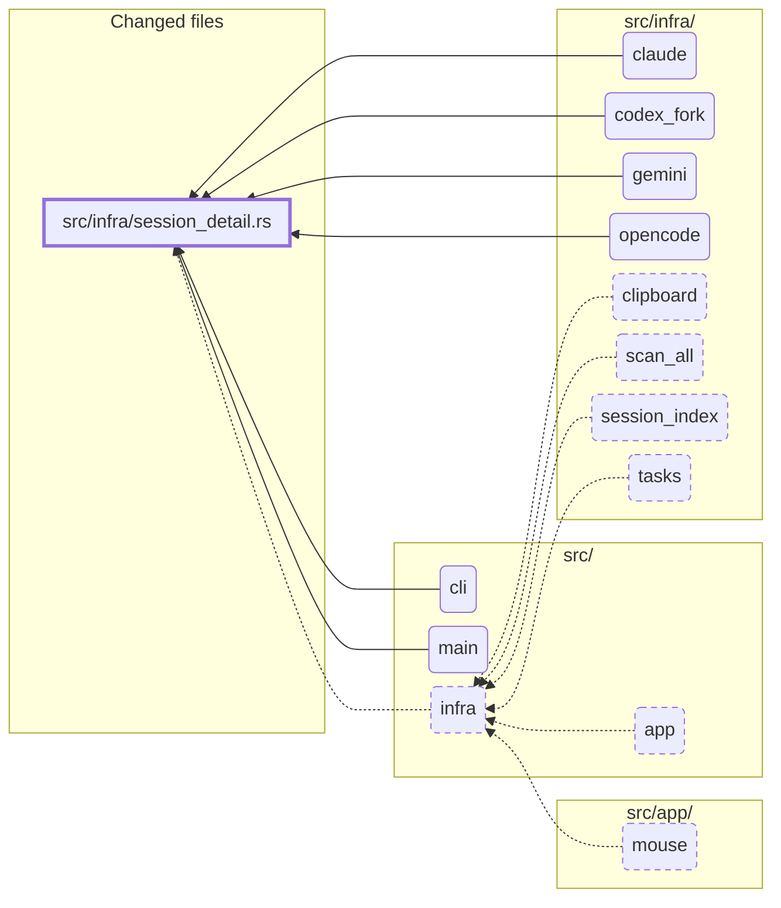

# Wingbox Pull Request Check

See what your pull request touches before you merge.

On every pull request this GitHub Action writes one comment that answers:
which modules use the files you changed, but are not part of the pull request?
Those are the places a change can break without showing up in the diff. The
comment says it in its first line:

> **Wingbox: 2 items touched by this change are used by 4 modules outside this pull request**
>
> `load_session_timeline` (function, `src/infra/session_detail.rs:97`) calls
> `detect_log_format`, which calls `looks_like_claude_jsonl`, which changed.
> These modules use it and are not in the pull request:
>
> - `src/cli` calls it at `src/cli/mod.rs:331` and in 1 more place
> - `src/infra/opencode` calls it at `src/infra/opencode.rs:992`
> - ...

You get:

- **What changed, and who uses it**: the comment names the function or type
  that holds the changed lines and the modules outside the pull request that
  use it, each with the place (`src/cli` calls it at `src/cli/mod.rs:331`). A
  changed private helper is reported through the public functions that call
  it. When what changed is not used outside the pull request (a comment, a
  test, a private item nobody calls), the comment is one sentence above its
  verdicts.
- **The tests to run**: the test files that use what changed, by name. And
  when a test changes together with the code it tests, the comment says so.
- **A review plan for an agent**: the same facts as S-expression lines, in
  the order to check, each with a file and a line. A reviewing agent goes
  through the list instead of searching the repository.
- **A strict result**: PASS, FAIL, UNKNOWN or NOT_APPLICABLE as an output of
  the action. A part that was not checked is UNKNOWN, never PASS.
- **Boundary findings first**: the layer, capability and pattern violations the
  pull request introduces (the ones the base branch does not have) lead the
  comment and its heading.
- **A picture and the rest, folded**: the blast radius as a diagram, the
  modules farther away, the tests and the files outside the code graph sit
  under one "More" line, so the comment stays short.
- **What was not checked**, said as such, so that silence is never read as a
  pass.

The comment is updated on each push, so a pull request never gets a second
one. The same report goes to the job summary of the workflow run, unfolded and
with every module listed. A pull request that changes no source file outside
the tests gets no comment; the job summary says so in one line.

The action uses [Wingbox](https://github.com/aileron-tech/wingbox), an
open-source code graph that is built on the runner, and installs
wingbox 0.14.0 from PyPI.

## What the comment looks like

The picture for a one-file change in a public Rust project (the whole comment:
[examples/rust-small.md](examples/rust-small.md)):



and the comment opens with what changed and who uses it (the commit changes
one private function, `looks_like_claude_jsonl`):

> ## Wingbox: 2 items touched by this change are used by 4 modules outside this pull request
>
> `load_session_timeline` (function, `src/infra/session_detail.rs:97`) calls `detect_log_format`, which calls `looks_like_claude_jsonl`, which changed. These modules use it and are not in the pull request:
>
> - `src/cli` calls it at `src/cli/mod.rs:331` and in 1 more place
> - `src/infra/codex_fork` calls it at `src/infra/codex_fork.rs:375` and in 1 more place
> - `src/infra/opencode` calls it at `src/infra/opencode.rs:992`
> - `src/main` calls it at `src/main.rs:426` and in 4 more places

The picture is folded under the line "More: the picture, 2 modules that use the
changed files but not what changed, 1 through a facade or declaration, 6 within
2 hops".

More examples, each the text the action would post, built locally and not
posted anywhere: [a larger change in the same Rust project](examples/rust-large.md)
and [fastapi/fastapi#16746](examples/fastapi-16746.md), a Python pull request
with several hundred dependents, where the diagram collapses folders into
counted boxes.

## Usage

```yaml
name: wingbox
on: pull_request
permissions: {contents: read, pull-requests: write}
jobs:
  check:
    runs-on: ubuntu-latest
    steps:
      - uses: actions/checkout@v4
        with: {fetch-depth: 0}
      - uses: aileron-tech/wingbox-action@v1
```

`fetch-depth: 0` is needed: the action compares the head of the pull request
with its base, so the base commit must be in the checkout.

The action installs Wingbox with the parser of every language
(`wingbox[all]`). It reads the repository and never runs it: every Python it
starts leaves the checkout off its module search path.

The action is a composite action (Python and git, no container), and its test
workflow runs it on `ubuntu-latest`, `macos-latest` and `windows-latest`.
Wingbox parses Python, TypeScript, Rust, C#, Java, Go, Ruby, PHP, Dart and
Free Pascal.

## Before a commit: check a working directory

The same check runs by hand on the files as they are on disk, so an agent (or
you) can read the plan before the commit and before a review:

```bash
python wingbox_pr.py --root /path/to/repository --base main --out /tmp/wingbox-out
```

With `--base` and no `--head` the change is the merge base of `--base` and
`HEAD` against the working directory: uncommitted edits and untracked files
included, git's ignore rules respected. Nothing is committed and the index is
left alone; Wingbox writes its graph into `.wingbox/` of the repository as it
always does. `--out` receives `wingbox-report.md` and `wingbox-plan.sexp`; the
result line is printed. It needs `wingbox` installed in the Python that runs
the script. `--head REF` checks a commit instead.

## Reading the comment

- **The heading and the first sentence** say how many modules outside the pull
  request use what it changes, and name the changed files they use. With new
  boundary findings the heading names them first. When no module outside the
  pull request uses a changed file directly and there is no new finding, the
  comment is one sentence, followed by the [verdicts](#verdicts).
- **New boundary findings**: findings of `wingbox boundaries` on the head that
  the base does not have. Known findings (in a baseline) and type-only imports
  are not counted, unless the pull request itself adds the baseline entry or
  edits the rules: see
  [A change that edits what it is checked by](#a-change-that-edits-what-it-is-checked-by).
  Without any, the comment says "No new boundary finding."
- **A changed item and its users**: the changed lines of the diff are sorted
  into the items Wingbox lists for the file (functions, types, constants).
  For each item that holds a changed line of code the comment names the
  modules outside the pull request that use it, how (calls, imports, uses as
  a type) and where. "X calls Y, which changed" means the change is in Y and
  X, which other modules use, calls it inside the same file. Comments, blank
  lines and the tests kept in a Rust file (`#[cfg(test)]`) change no item.
- **Tests that use what changed**: the test files that use a changed item
  (or, for a file taken as a whole, the file). The comment names five and
  counts the rest; the job summary names all.
- **Tests changed together with the code they test**: a changed test file
  that uses a changed source file directly and loses or replaces a line of
  code in the same pull request. New tests (lines only added) are not
  flagged.
- **Tests deleted together with the code they tested**: a test file the pull
  request deletes that used a changed source file directly on the base
  (`test-deleted` in the plan). What it checked is no longer checked.
- **A changed method**: inside a class, the changed line belongs to the method
  that holds it, named `Class.method`. Its users are the modules that use the
  class and call a method of that name; a module that uses the class but not
  the method is counted under "More", not listed. A change of a field or of
  the constructor is a change of the class.
- **Other code changed too**: lines outside every listed item (an import, a
  Rust `impl` block, a statement at the top level) cannot be given to an
  item, so the modules that use the file are listed as a whole.
- **The list of a file**: modules that import or use a changed file and are not changed
  themselves. Where Wingbox follows a name to the file that defines it, the
  row says which names (at most three, then a count). Wingbox 0.10.1 does
  this for Rust; for the other languages the row names the module (and the
  changed file, when the pull request changes several).
- **More** (folded in the comment, open in the job summary):
  - the diagram;
  - **through a module facade or declaration**: modules that reach a changed
    file only through the file that declares or re-exports it (`mod.rs`,
    `lib.rs`, `__init__.py`, an `index.ts`) without naming an item of it.
    They see the change only if it alters something they use, so they are
    counted, not listed;
  - **within N hops**: modules that depend on a direct dependent, counted by
    folder;
  - **tests** that use the changed code, counted apart;
  - the changed files that are not in the code graph.
- **Not checked**: the parts of the repository `wingbox boundaries` could not
  check (rules it cannot read, no layered style, too few files). No finding
  there is not a pass, and the comment says so.

### The review plan

The comment carries a folded block "Review plan for an agent", and the action
writes the same plan to a file (output `plan`). It is a list of S-expression
lines in the order to check:

```lisp
(review-plan :schema 1 :result UNKNOWN :execution ok :base <sha> :head <sha> :wingbox "0.14.0" :hops 2 :checked <sha> :tree merge)
(reason "not-checked: . (no-layer-style)")
(changed-item "src/billing/invoice.py" total :kind fn :line 12 :how changed)
(look "src/api/orders.py" 40 :module src/api/orders :why call :item total :places 2)
(run-test "tests/test_invoice.py" :uses total :evidence passed :cases 4)
(required-test "tests/test_refunds.py::test_refund" :group billing :evidence passed :cases 1)
(tests :evidence complete)
(test-case "tests/test_invoice.py" "tests.test_invoice" "test_total" :status passed)
(test-report "test-results/junit.xml" :sha256 <digest> :cases 212)
(test-changed "tests/test_invoice.py" :tests "src/billing/invoice.py")
(not-checked "." :reason no-layer-style)
(changed-file "src/billing/invoice.py" :sha256 <digest> :commit <sha>)
```

`look` is a place outside the pull request that uses a changed item: open it.
`look-module` is a module that uses a file whose other code changed.
`run-test` is a test that uses what changed, `required-test` a test the
manifest of the repository requires for this change, and `test-case` a case
the test reports hold of such a test. `changed-item ... :how calls
:via (a b)` means the item calls `a`, which calls `b`, which changed.
`changed-file` gives the SHA-256 of the file in the commit that was checked,
what `git show <commit>:<path> | sha256sum` prints, so a reader can check that
it looks at the same content. To hand the plan to a reviewing
agent in the same job:

```yaml
      - uses: aileron-tech/wingbox-action@v1
        id: wingbox
      - run: cat "${{ steps.wingbox.outputs.plan }}"   # or pass the path to your review step
```

### The result

The action sets the outputs `result`, `execution` and `reasons`:

| result | when |
|---|---|
| `FAIL` | the pull request introduces a layer, capability or pattern violation, also one that only its own edit of a baseline or of the rules accepts |
| `UNKNOWN` | a part of the repository was not checked; a wingbox command ended abnormally (`execution` is then `error`); files of a language were left out because its parser is not installed; or the files checked are not the commit the report names |
| `NOT_APPLICABLE` | no source file outside the tests changed |
| `PASS` | none of the above |

`fail-on: strict` fails the job on `FAIL` and on `UNKNOWN`. The result is
about the boundary rules; the list of who uses what changed is information for
the reviewer and never fails a job.

### Verdicts

The result answers one question: does this change introduce a boundary
finding. A run answers more, and the comment, the job summary and the
evidence record keep the answers apart, always these six in this order:

| Verdict | In the record | Says |
|---|---|---|
| Boundaries, introduced by this change | `boundaries.introduced` | the result above (`PASS`, `FAIL`, `UNKNOWN`, `NOT_APPLICABLE`) with the number of findings and of violations |
| Boundaries, there before this change | `boundaries.existing` | `PRESENT` with the number of violations the head holds that the base has too and the first of them; `NONE`; or `UNKNOWN` when none was found but not everything was checked |
| Baseline | `baseline` | `ACCEPTED` with the number of breaks the baseline accepts and each entry with its owner, reason and end date; `EXPIRED` when an entry is past its end date (its break is a violation again); `NONE`; `UNKNOWN` |
| Tests | `tests` | the test evidence in one word (`tests.evidence`), see [Evidence that the tests ran](#evidence-that-the-tests-ran) |
| Coverage | `coverage` | complete or not, with the reasons, see [What the run covered](#what-the-run-covered) |
| Eligible as evidence | `eligible`, `eligible-reasons` | `true` only when none of the five is failed, unknown, incomplete or expired |

A record is eligible when the change introduces no violation, the head holds
none from before, no baseline entry is past its end date, the test evidence
is `complete` and the coverage is complete. Every other state gives a reason
in `eligible-reasons`, for example `boundaries-existing: 1 violation(s)`,
`baseline: 1 past the end date`, `tests: none-found` or `coverage:
incomplete`. A violation that a baseline entry accepts within its terms does
not count against the record; one without an entry does, old or new.

`fail-on: existing` fails the job when the head holds a violation, one the
pull request introduces or one that was there before. `fail-on: strict` keeps
its meaning: a violation that was there before, an expired baseline entry, the
test evidence or `eligible` does not fail it. The outputs `eligible`,
`existing-violations`, `baseline-accepted` and `baseline-expired` (GitLab:
`WINGBOX_ELIGIBLE`, `WINGBOX_EXISTING_VIOLATIONS`, `WINGBOX_BASELINE_ACCEPTED`,
`WINGBOX_BASELINE_EXPIRED`) hold the same for a later step.

### A change that edits what it is checked by

The result rests on files of the repository itself. The check knows them as
policy files:

| File | What it is |
|---|---|
| `.wingbox/baseline.sexp` | the breaks of the rules that are accepted |
| `.wingbox/config.yaml`, `.wingbox/learned.sexp`, the layers `.wingbox/decisions.sexp` sets | the boundary rules |
| a rule file the project declares (a dependency-cruiser layer list and the like), as the graph of the base or of the head names it | rules the project declares |
| the workflow that runs the check (the file GitHub or GitLab names for the run, and any changed workflow file that names wingbox) | the workflow |
| `.wingbox/required-tests.yaml`, or the manifest whose path the job gives | the tests a change must pass |
| `.wingbox/controls.yaml`, or the mapping whose path the job gives | the mapping from controls to evidence |

A pull request that edits one of them would be judged by its own edit: a
break of a rule together with a new baseline entry for it used to pass. So:

- The report has the section **This change edits what it is checked by**
  with each such file, the plan a `(policy-changed "<path>" :kind <kind> :how
  added|changed|removed)` line, the evidence record the object `policy`, and
  the output `policy-changed` their number. The `paths` input does not hide
  them.
- **The findings are judged with these files as the base has them.** When
  the pull request edits the baseline or a rule file, the action builds the
  head once more in a temporary git worktree in which these files are the
  base's (absent when the base has none), and never touches the checkout. A
  finding that build gives and the base does not have is introduced, like one
  the head gives under its own files. The row of such a finding says what
  alone accepts it: the pull request's own baseline entry, or its edit of the
  rules. The base is the merge base; for a checkout of the merge of the head
  into the base it is the base as merged (`policy-of-base` in the plan).
- **A new or changed baseline entry needs an owner, a reason and an end
  date** (`:owner "<who>" :reason "<why>" :expires YYYY-MM-DD`, read by
  Wingbox 0.13 and newer). With all three, the break it lists is accepted:
  the report lists it under "Accepted by this change itself" and it is no
  violation. An entry without them accepts nothing in the check, and after
  the end date Wingbox reports the break as a violation again. An edit of the
  rules accepts nothing in the pull request that makes it: change the rules
  in a pull request of their own, then the code.
- **`policy-change`** says what the change of a policy file itself does:
  `fail` fails the job, `report` only reports. Without a value it is `fail`
  with `fail-on: strict` and `report` otherwise. It does not change the
  result of the boundary check.
- A policy file of `.wingbox/` that is on disk but not as in the commit
  checked (written by an earlier step of the job) makes the result `UNKNOWN`,
  like any other file that differs from the commit.

Who may approve such a change is not something a check can decide: that is
the platform's. A setup that separates the duties:

```
# .github/CODEOWNERS (GitLab: CODEOWNERS)
/.wingbox/            @your-org/architecture-owners
/.github/workflows/   @your-org/architecture-owners
```

with a branch rule that requires the review of a code owner, who is
someone other than the author (GitHub: "Require review from Code Owners" and
at least one approval; GitLab: code owner approval, "Prevent approval by
author" and "Prevent approvals by users who add commits"), and no approval
right for the account of a coding agent that writes changes. With that in
place `policy-change: report` leaves the decision to those reviewers; without
it keep `fail`, and merge a change of the policy files by someone who may
override the check.

### Which commit was checked

The graph is built from the files of the checkout, so the report says which
commit these files are (`:checked` in the plan) and how it relates to the head
of the pull request (`:tree`):

| tree | the checkout is |
|---|---|
| `head` | the head commit itself |
| `merge` | the merge of the head into the base: what `actions/checkout` gives on `pull_request`, and what would land |
| `other` | another commit: the result is `UNKNOWN` |

Before it builds the graph the action compares the checkout with that commit.
A tracked file that was changed, or an untracked source file, is named
(`tree-differs`) and makes the result `UNKNOWN`: the report would describe
files that are in no commit. Files git ignores, `.wingbox/` and files that are
not source (a test report, a build log) do not count. To check exactly the
head commit, check it out:

```yaml
      - uses: actions/checkout@v4
        with:
          fetch-depth: 0
          ref: ${{ github.event.pull_request.head.sha }}
```

### Evidence that the tests ran

The check names the tests that use what changed; it never runs them. When
the job runs its tests before the check and they write JUnit XML reports,
hand these over:

```yaml
      - id: tests
        run: python -P -m pytest --junitxml=test-results/junit.xml
        continue-on-error: true      # failing tests must not end the job before the check
      - uses: aileron-tech/wingbox-action@v1
        if: ${{ !cancelled() }}
        with:
          test-results: test-results/*.xml
          test-step-outcome: ${{ steps.tests.outcome }}
          require-tests: true     # optional: fail unless every test that uses what changed has a passed record
      - if: ${{ steps.tests.outcome != 'success' }}
        run: exit 1                  # the job fails when the tests did
```

A test step that fails ends a job, and every later step is skipped: the check
would leave no report and no record for the run that needs them most. So the
test step gets `continue-on-error: true`, the check runs unless the job was
cancelled, and a last step fails the job when the tests did not succeed.
`test-step-outcome` tells the check how the test step ended (`success`,
`failure`, `cancelled` or `skipped`, what `steps.<id>.outcome` gives). It is
recorded (`tests.step-outcome`), and after `failure` the test evidence is
`failed` whatever the reports hold: a report may be missing or cut short.
After `cancelled` or `skipped` it is not `complete`.

Each `run-test` line of the plan then says what the reports hold about that
test, with the number of recorded cases:

| evidence | the cases recorded for the test |
|---|---|
| `passed` | every one passed |
| `failed` | one failed |
| `partial` | one passed, and another was skipped or did not run; the line counts them (`:passed 3 :skipped 1`) |
| `skipped` | none passed |
| `no-record` | the reports hold none |

Every case is a `test-case` line: the test, where the report puts the case
(its class name, else its file, else its suite), its name and its status.
Each report file is named with its SHA-256 (`test-report`). The comment counts
the tests: "Tests that use what changed (5): 3 passed, 1 with a case skipped
or not run (`tests/test_auth.py`: 1 of 2 cases passed), 1 without a record in
the test report". Only `passed` counts as passed, in the comment, in the
outputs and for `require-tests`. Without `test-results` every line says
`:evidence none`.

A test is matched with the cases of its file: by the file a report names, by
the dotted class name of a Python test, by the end of a Java or C# class
name. A Go report names a package and a test function, never a file, so the
action asks Wingbox for the functions of each Go test file: a record goes to
the file that holds its function (a subtest `TestX/name` goes with `TestX`),
and a `Test...` function of the file that no report names is a case
`no-record`. A report that declares a document type, or is not a JUnit
report, is refused and named. `require-tests` is separate from `fail-on`: it
does not change the result of the boundary check.

### Where a test report comes from

A report file proves what it holds, not where it comes from. The action
judges each report by what the job knows and refuses one that contradicts
it. A refused report counts as no evidence: its cases are left out, the plan
names it (`test-report-refused`, with the reasons), so do the comment and the
record, and the output `test-reports-refused` counts it. A report is refused
when:

- it is a file tracked by git: a report of this run is written by the test
  step, not committed;
- it was last modified, or one of its suites states a timestamp,
  before the start of the run. On GitHub the start is the start of the job
  (the moment the runner wrote the event file of the job). On GitLab it is
  the creation of the pipeline, with five minutes of tolerance for the other
  clock. By hand it is not known and nothing is compared. A timestamp
  without a zone is read both as UTC and as the local time of the runner,
  and refused only when both are before the start;
- it names a commit other than the commit checked: a property or an
  attribute of a suite called `commit`, `git.commit`, `revision`, `sha`,
  `GITHUB_SHA` or `CI_COMMIT_SHA`, of 7 to 64 hexadecimal digits;
- its sidecar (below) differs or cannot be read.

The record states for each report its SHA-256, the timestamp it states, the
modification time of the file, whether git tracks it, the commits it names
and the state of its sidecar; and once for the run the provider, the run,
the attempt and the job (`run`), the commit checked, the start of the run
and the test command (`tests.provenance`). The test command is the input
`test-command`: recorded verbatim, never run.

```yaml
      - uses: aileron-tech/wingbox-action@v1
        with:
          test-results: test-results/*.xml
          test-command: python -P -m pytest --junitxml=test-results/junit.xml
```

The strict form: the test step writes a sidecar beside each report, named
`<report>.run.json`:

```json
{"commit": "<sha>", "run-id": "9000000001", "attempt": "1", "command": "python -P -m pytest --junitxml=test-results/junit.xml", "sha256": "<digest>"}
```

`commit` is the commit the tests ran on (`git rev-parse HEAD`), `run-id` and
`attempt` are `GITHUB_RUN_ID` and `GITHUB_RUN_ATTEMPT` (in GitLab
`CI_PIPELINE_ID` and an empty attempt), and `sha256` is the SHA-256 of the
report file. A sidecar matches when these are what the job itself knows.
With `require-test-provenance: true` a report without a sidecar is refused.
A sidecar that matches and names this run stands in for the comparison of
times: a report made by an earlier job of the same run and handed over as an
artifact is older than this job on GitHub, and is accepted with its sidecar.

```yaml
      - run: python -P -m pytest --junitxml=test-results/junit.xml
      - if: ${{ !cancelled() }}
        shell: bash
        run: |
          printf '{"commit": "%s", "run-id": "%s", "attempt": "%s", "command": "%s", "sha256": "%s"}\n' "$(git rev-parse HEAD)" "$GITHUB_RUN_ID" "$GITHUB_RUN_ATTEMPT" "python -P -m pytest" "$(sha256sum test-results/junit.xml | cut -d ' ' -f 1)" > test-results/junit.xml.run.json
```

### Required tests

The tests the graph finds are those that use what changed. To say which tests
a change must pass whatever the graph finds, keep a manifest in the
repository, `.wingbox/required-tests.yaml` (or the path of the input
`required-tests`):

```yaml
# .wingbox/required-tests.yaml
billing:
  paths:
    - "src/billing/**"
    - src/models/invoice.py
  tests:
    - tests/test_invoice.py
    - tests/test_billing.py::test_total
```

A group has a name, the `paths` it applies to and the `tests` a change of
those paths must pass. A path is a glob as the `paths` input takes it (`*`
and `**` cross folders), a folder ending in `/`, or a module (a file without
its ending). A test is a test file, matched like a test to run, or one case
written `<file, class or Go folder>::<case>`:
`tests/test_billing.py::test_total`, `com.shop.OrderTest::total`,
`pkg/billing::TestInvoice`. The parameters (`test_total[1]`) and the subtests
(`TestInvoice/zero`) of that case count.

The file is YAML in a small subset, which the action reads without a YAML
library: a group name and a colon at the start of a line, the two keys
`paths` and `tests`, one `- item` per line, plain or in quotes (quote an item
that starts with `*`), comments on lines of their own. Anything else refuses
the whole manifest, with the line and the reason, and the test evidence is
then `incomplete`: what the change must pass is not known.

For a change that touches a path of a group, every test of the group is a
`required-test` line of the plan with its evidence, the comment counts them
("Required tests (2, by `.wingbox/required-tests.yaml` of the base): 1
passed, 1 without a record in the test report"), and the evidence record
lists each with its group and its status. The manifest is read from the base
commit when the base holds it, so a change cannot drop a requirement it is
judged by; a manifest that only the pull request adds is read from the
checked files.

The test evidence of a run is one word, the output `tests-evidence` and
`tests.evidence` of the record:

| evidence | when |
|---|---|
| `none` | no `test-results` were given |
| `none-found` | reports were given, no test uses what changed and none is required: the reports say nothing about this change |
| `failed` | a test to run or a required test has a failed case, or the test step of the job failed (`test-step-outcome`) |
| `incomplete` | one of them has a case that was skipped or did not run, or no record; or the manifest could not be read |
| `complete` | every recorded case of every test to run and of every required test passed |

`require-tests: true` fails the job unless every test to run and every
required test is `passed`. A change for which no test was found passes, and
the log says so. `require-tests: strict` also fails such a change when it
holds source code outside the tests; a change of documents only passes.

### The evidence record

Each run also writes `wingbox-evidence.json` (output `evidence`; in GitLab in
`wingbox-out/`): one JSON document for a system that keeps evidence of change
control. It holds the repository and the run, the base, the head, the commit
that was checked, the result with its reasons, the verdicts kept apart
(`boundaries.introduced`, `boundaries.existing`, `baseline`, `eligible`), the policy files the change
edits (`policy`), what the run analysed and left out (`coverage`), the counts, the changed files
with their SHA-256, the tests to run and the required tests with their
evidence and every recorded case, the manifest of required tests as it was
read, the test reports with where each comes from, the controls of the team's
mapping with what the record supports for each (`controls`, see
[Control mapping](#control-mapping)), and the SHA-256 of the
report and of the plan written beside it. Its shape is
[`schema/wingbox-evidence-2.schema.json`](schema/wingbox-evidence-2.schema.json)
(`"schema": "wingbox-evidence/2"`); a record of 1.4 says `wingbox-evidence/1`
and follows [`schema/wingbox-evidence-1.schema.json`](schema/wingbox-evidence-1.schema.json).
Version 1 is superseded: it has one word for the result, and none of the
verdicts, `policy` or `coverage`.

A record is written also when the check did not run. When the install of
Wingbox fails, or the check ends before it wrote its record, the last step of
the action writes one with the result `UNKNOWN`, the execution `error` and the
one reason `check-did-not-run`, the run, the commits named, the outcome of the
test step and the test command. The output `evidence` names it.

[`examples/evidence-handover.yml`](examples/evidence-handover.yml) is a
workflow in two jobs: the check, which reads the pull request and holds no
secret but the default token, and a hand-over job that never checks out the
code, takes the record as an artifact and posts it to an HTTP endpoint with a
secret only that job holds. Its test step, check and upload are written as
above, so a run whose tests fail hands over its record too.

### What the run covered

A result speaks for what was analysed. The record says what that was, in its
object `coverage`, so that a system reading it does not have to parse the
reasons:

| Field | Holds |
|---|---|
| `repository`, `commit`, `tree` | the repository, the commit whose files were analysed, and how it relates to the head |
| `languages` | per language the files in the graph (`analysed`) and the files left out because its parser is not installed (`skipped`) |
| `parts` | each part of the repository with its architecture style, its modules, whether its rules were checked, and the reason when not (from `wingbox boundaries --strict`); files outside every part are a part `-` with the reason `in-no-part` |
| `excluded` | `paths`: the patterns of the `paths` input and the changed files they left out; `gitignore`: the source files and the folders git ignores on disk, which Wingbox does not read; `folders`: tracked source files in a folder Wingbox leaves out by its name (`vendor`, `node_modules`, `dist`, `build`, `target` and the like), per folder name |
| `graph` | the state of the graph, `FRESH`, `STALE` or `UNKNOWN`, with the reason, the digest of its source files, the commit it was built from and the Wingbox version (its `built-from` fact), and the number of changed files it misses |
| `not-seen` | what a graph built from the source text does not see: reflection, imports built from strings, calls through an untyped receiver; the last with the number of such calls where Wingbox counts them |

`coverage.complete` is `true` when nothing was left out: every language
parsed, every part checked, no changed file left out by `paths`, the checkout
at the commit named with no file changed, no failed command, the graph
`FRESH`. Otherwise it is `false` and `coverage.reasons` says why, in the words
of the reasons of the result where both say the same. The graph is `FRESH`
when this run built it and no command found a changed file; `STALE` when a
Wingbox command says it misses changed files or it was built from another
commit; `UNKNOWN` when the build failed, the graph could not be confirmed, or
it does not say what it was built from (Wingbox before 0.13, which also does
not name the parts it checked). A stale or unknown graph is never an empty
field, and never complete. What `excluded` and `not-seen` list is how the
analysis is made: it is stated, and does not make a run incomplete.

The output `coverage-complete` (GitLab: `WINGBOX_COVERAGE_COMPLETE`) holds
`true` or `false`, and the plan has a `(coverage :complete true|false :graph
<state>)` line with a `coverage-gap` line per reason.

### The diagram

GitHub draws the diagram from a `mermaid` block in the comment; no image is
uploaded and nothing is stored. An arrow points from a module to what it uses.
A thick border marks a changed file, a solid border a direct dependent, a
dashed border a module that reaches a changed file through a facade, a
declaration or within N hops. Modules are grouped by folder. Changed files
that no unchanged module uses are left out.

The diagram never has more than 40 boxes and 60 arrows. A larger blast radius
is collapsed: the farther modules of a folder become one box with their count,
then the direct ones, then the changed files; every module is still counted in
a box. If that is still too much, the largest boxes are kept and the line
under the diagram says how many modules, files and arrows are not drawn. The
same pull request always gives the same diagram.

## The evidence package

A run leaves three loose files. With `package: true` (in GitLab `WINGBOX_PACKAGE: "true"`) it also
writes one archive that stands on its own, `wingbox-package.zip` (output `package`, in GitLab in
`wingbox-out/`): the record, the report and the plan, the test reports the record names as they are
on disk, the policy files as the commit checked holds them, the schemas, and `manifest.json`, which
names every member. A reviewer who was not there can check it without the CI system.

The package is built and checked by a command of this repository, usable in CI and by hand. The
library that will carry it installs the same command under the name `wingbox-evidence`.

```bash
python wingbox_evidence_cli.py pack --run-dir DIR --out package.zip [--repo DIR] [--reports-root DIR] [--job-log FILE] [--policy PATH] [--workflow PATH] [--stated NAME=VALUE] [--retention TEXT]
python wingbox_evidence_cli.py verify package.zip [--repo DIR] [--manifest-sha256 HEX] [--json]
python wingbox_evidence_cli.py review package.zip --reviewer NAME --decision accepted|rejected --grounds TEXT [--time UTC]
```

| Exit status | Meaning | Last line of the output |
|---|---|---|
| 0 | the command did its work and the result is good | `pack: complete`, `verify: ok`, `review: recorded` |
| 1 | the command did its work and found a defect | `pack: incomplete (...)`, `verify: failed (...)`, `review: not recorded (...)` |
| 2 | wrong usage: an option, a file that is not there, an archive that would be written over | nothing on the standard output; the reason on the error stream |

**`pack`** reads the run folder (`wingbox-evidence.json` and the documents it names), copies each
test report the record names byte for byte from `--reports-root` (default `--repo`), with the
sidecar beside it, and the job log when `--job-log` gives one. A path of the record that leads out
of that folder is not read. The policy files come from the commit the record says was checked, as
`git show <commit>:<path>` gives them, never from the working folder: `.wingbox/baseline.sexp`,
`.wingbox/config.yaml`, `.wingbox/learned.sexp`, `.wingbox/required-tests.yaml`, the files the
record says the change edits, the manifest of required tests it read, and the ones named with
`--policy` and `--workflow` (the CI configuration that ran the job; the action names its workflow
file). `--stated` records a version the job states (`build`, `model`, `prompt`, `tool-schema`,
`test-data`) and `--retention` how long the job keeps the package, both as given. `pack` reads no
clock: the time in the manifest is the time of the record. It never writes over a file.

Members of the archive:

| Member | What it is |
|---|---|
| `manifest.json` | the manifest, first in the archive |
| `record/wingbox-evidence.json`, `record/wingbox-report.md`, `record/wingbox-plan.sexp` | the record and the documents it names |
| `sources/test-reports/<path>`, `<path>.run.json` | each test report the record names, and its sidecar, as on disk |
| `sources/job-log/<name>` | the job log, when given |
| `policy/<path>` | each policy file as the commit checked holds it |
| `schema/*.schema.json` | the schemas of the record, the manifest and the review |
| `reviews/0001.json`, ... | the decisions of reviewers, added by `review` |

A member name is a safe relative path: a character outside `A-Z a-z 0-9 . _ -` of a path of the
repository is written `%XX`.

**The manifest** ([`schema/wingbox-package-1.schema.json`](schema/wingbox-package-1.schema.json),
`"schema": "wingbox-package/1"`) holds: the bundle id (the SHA-256 of the lines `<sha256>  <path>`
of the members by path, what `sha256sum` prints); `state`; the time, the tool, the subject and the
run with its address, taken from the record; `retention` and `stated`; `control` (the
[control mapping](#control-mapping) the record evaluated, with the state of each control; `"mapping":
"none"` with empty values when the record evaluated none); `policy` (the commit, and
each policy file as `present`, `not-in-commit` or `not-read`); `checks`; `members` (each with id,
path, role, media type, length, SHA-256, whether it is required, its source and, for a policy file,
its commit); `required` (each as `present`, `absent`, `differs` or `unreadable`); `optional` (the
job log); `absent`; `statements`; `attestation`.

Required are the record, every document and every test report the record names (each with the
SHA-256 the record gives for it), the schemas, and that the commit checked could be read for its
policy files. A required member that is not there, or is there with other bytes, makes the package
`incomplete`: the manifest says so and `pack` ends with status 1. The package is written all the same.

`checks` lists every required test and every test that uses what changed with its exact
identifier and one outcome, and each recorded case with one:

| In the record | Outcome |
|---|---|
| `passed` | PASS |
| `failed` | FAIL |
| `skipped` | SKIP |
| `no-record`: the reports given hold no record of it | NOT RUN |
| `none`: no test report was given | UNKNOWN |
| `partial`: a case passed, another was skipped or has no record | NOT RUN when a case has no record, else SKIP |

Three statements stay apart, in the manifest and in what `verify` prints: the record states which
checks ran and how each ended; a review states that a person accepted or rejected the evidence;
nothing in a package states that a control conforms.

**The archive** is a zip file in one fixed form, so the same inputs give the same bytes and a
package can be built again and compared: the manifest first, then the members by path, then the
reviews; every member stored without compression (a compressor may give other bytes on another
machine), dated 1980-01-01 00:00:00, with no extra field and no comment, as a regular file.

**`verify`** reads the archive in memory. It unpacks nothing and runs nothing, and needs neither
the repository nor the CI system. It ends with status 0 only when everything matches:

| Problem | Meaning |
|---|---|
| `archive` | not an archive of this form: a compressed or encrypted member, a comment, bytes that belong to no member |
| `unsafe-member-name`, `link-member` | a member name that is absolute, leaves the folder, holds a backslash or a colon; a symbolic link |
| `too-large` | larger than `--max-bytes` (default 256 MiB) |
| `missing-member`, `altered-member`, `duplicate-member`, `unexpected-member` | a member the manifest names is not there, has other bytes, is there twice; a member the manifest does not name |
| `manifest-invalid`, `manifest-mismatch` | the manifest does not meet its schema; computed again from the members it is not the same |
| `manifest-digest` | the manifest is not the one whose SHA-256 was given with `--manifest-sha256` |
| `review-invalid` | a review is not a review record, is about another manifest, or the review before it was removed or changed |
| `incomplete` | the manifest itself says a required member is absent |
| `commit-not-found`, `policy-differs-from-commit`, `file-differs-from-commit`, `not-recomputable` | with `--repo`: the repository lacks the commit; a policy file or a changed file of the record is not what the commit holds |

With `--repo DIR` it also reads every policy file and every changed file of the record from the
commit named and compares the SHA-256. `--json` prints the check as one value.

**`review`** adds the decision of a person as the member `reviews/NNNN.json`
([`schema/wingbox-review-1.schema.json`](schema/wingbox-review-1.schema.json)): its number, the
SHA-256 of the manifest reviewed, the bundle id, the reviewer, `accepted` or `rejected`, the
grounds, the time (`--time`, else now) and the SHA-256 of the review before it. Every earlier
member keeps its bytes and its place; only the directory at the end of the archive is written
again. A package that does not verify is not reviewed. An incomplete one can be: the decision is
the reviewer's.

What a matching digest shows, and what it does not. `verify` shows that the bytes are what the
manifest says and that the manifest is what its members give. It does not show who made the
package: the manifest holds neither its own digest nor a signature, so someone who can write the
archive can replace it whole, or drop its last review. Note the `manifest-sha256` that `pack`
and `verify` print somewhere the archive is not kept, and give it back with `--manifest-sha256`.
A detached attestation of the manifest has its place, the member
`attestation/manifest.json.attestation` (named in the manifest under `attestation`): `pack` writes
none and `verify` reports one as present and not checked. Signing with keys is not part of this
command.

In a workflow:

```yaml
      - uses: aileron-tech/wingbox-action@v1
        id: wingbox
        with:
          package: true
      - uses: actions/upload-artifact@v4
        if: ${{ !cancelled() }}
        with:
          name: wingbox-package
          path: ${{ steps.wingbox.outputs.package }}
```

The step fails when the package is incomplete (`package-state` says `incomplete`, and the log
names what is absent). The action has no access to the log of its own job; add it by hand with
`pack --job-log` where the CI system hands it out. When the check did not run, the package holds
the record that says so, and the policy files of the head it names; that step of the action reads
the commit from the workspace folder, so with another `working-directory` its package is incomplete.

## Evidence over a period

One record, or one package, says what one run found. A reviewer who has to judge a period needs
every run of it: the failed and the unknown ones, each change of the rules, the accepted breaks
that came and went, and the stretches in which nothing was checked. Two more commands keep that:

```bash
python wingbox_evidence_cli.py append --ledger ledger.jsonl (--package package.zip | --record wingbox-evidence.json)
python wingbox_evidence_cli.py period --ledger ledger.jsonl --from DATE --to DATE [--repo DIR [--branch NAME]] [--max-gap-hours N] [--head-sha256 HEX] [--json]
```

They end with the same exit statuses as the other commands: 0 (`append: recorded` or
`append: already recorded`, `period: ok`), 1 (`append: not recorded (...)`: the ledger or the
package does not verify, or the file is no record; `period: failed (N defects)`: the ledger is
broken or the period has a gap), 2 for wrong usage.

**The ledger** is a text file with one line per run, added at its end and never changed
([`schema/wingbox-ledger-1.schema.json`](schema/wingbox-ledger-1.schema.json)). A line is JSON
with its keys in order and no space: the key of the run (provider, repository, run id, attempt,
job), the time of the record, the repository, the change, the base, the head and the commit
checked, the verdicts (`boundaries`, `existing`, `baseline`, `tests`, `coverage`, `execution`),
`eligible` with its reasons, the policy files the change edits, the accepted breaks with owner and
end date, the SHA-256 of the record, and of the package the SHA-256 of its manifest (what a review
names, and what stays the same when reviews are added), its bundle id and its state. `append`
reads no clock, opens the file to add to, and writes one line; a record that is already in the
ledger is not added twice, and nothing is added to a ledger that does not verify.

Each line holds its number and the SHA-256 of the line before it, without its line end. So a
line that was removed or changed breaks the chain where it happened, and anyone can check it:
`sed -n 2p ledger.jsonl | tr -d '\r\n' | sha256sum` is the `previous` of line 3. The last line has
no line after it: `append` and `period` print its SHA-256 (`head-sha256`, the output
`ledger-head`). Kept where the ledger is not, and given back with `--head-sha256`, it shows that
no line was cut from the end.

The tool writes and verifies; it hosts nothing. Where the ledger is kept is the team's choice: a
branch, an artifact store, the receiving system. In the action, `ledger: PATH` (in GitLab
`WINGBOX_LEDGER`, a path from the project folder; with the template for shell runners a file in
`wingbox-out/`) adds the line of the run to the file at that path, from the package when
`package: true` and else from the record, also for a check that did not run. Fetch the file
before the step and store it after, for example on a branch of its own:

```yaml
    concurrency: evidence-ledger          # one writer at a time: two lines added side by side break the chain
    steps:
      - uses: actions/checkout@v4
        with:
          fetch-depth: 0
      - uses: actions/checkout@v4
        with:
          ref: evidence-ledger
          path: evidence-ledger
      - uses: aileron-tech/wingbox-action@v1
        with:
          package: true
          ledger: evidence-ledger/ledger.jsonl
      - run: git -C evidence-ledger add ledger.jsonl && git -C evidence-ledger -c user.name=ci -c user.email=ci@example.invalid commit -q -m "one run" && git -C evidence-ledger push
```

That job needs `contents: write` and the `concurrency` group; a pull request from a fork cannot
push, so there the line is written by a job that can (a run on the default branch).

**`period`** reads a ledger and counts what it recorded between two dates. A day (`2026-01-31`)
as `--to` belongs to the period; a moment (`2026-01-31T12:00:00Z`, UTC) ends it and is left out.
The report, as text or with `--json`
([`schema/wingbox-period-1.schema.json`](schema/wingbox-period-1.schema.json)):

- what it is: a count of what the ledger recorded in the period, for a reviewer. It does not conclude that a control operated effectively;
- the ledger: its lines, whether the chain is intact, the SHA-256 of its last line;
- the runs of the period: how many, how many eligible as evidence, `failed` and `unknown`, and
  the number by the word of each verdict and by the state of the package;
- every run that is not eligible, `failed` (a verdict found a defect: a boundary finding
  introduced, a violation on the head, a baseline entry past its end date, a failed test) or
  `unknown` (not eligible, and no verdict found one), with its reasons and what followed it: the
  first later eligible run on the same change (the same pull or merge request; outside one, the
  same head), or none;
- every change of a policy file, with the run that showed it;
- the accepted breaks of the period, each with owner and end date, the runs that held it, and in
  how many of them it was past its end date;
- the gaps. With `--repo DIR --branch NAME` (default `HEAD`) the ledger is compared with the
  first-parent commits of that branch whose time is in the period: a commit a line names as its
  head or as the commit checked has a record; a merge commit that no line names, while a line
  names the head it merged, is listed apart (only their merged head has a record); every other
  commit is listed as without a record, never skipped. With `--max-gap-hours N` every stretch
  without a run longer than N hours is listed, from the start of the period and to its end too.

A commit without a record, a stretch over the limit and a broken ledger are defects: status 1.
Failed and unknown runs are counted and listed, not judged. `period` reads no clock either: the
period is taken as given, so one that ends in the future ends with a stretch.

## Control mapping

A record says what a run checked. It does not say which control of a team's management system the run is
evidence for. A team keeps that mapping by hand, and nothing checks that the evidence a control names was
in fact produced. The control mapping is that list as a file of the repository, and each run evaluates it:

```yaml
# .wingbox/controls.yaml
format: wingbox-controls/1
mapping:
  name: "Example team control map"
  version: "2026.1"
  owner: "Engineering lead"
controls:
  SDLC-03:
    title: "Changes are checked against the architecture rules"
    status: approved
    approver: "Head of engineering"
    approval: "CAB-2026-014"
    valid-from: "2026-01-01"
    valid-until: "2026-12-31"
    risk: "RISK-07"
    method: static-analysis
    claim: "The change introduces no violation of the declared architecture rules, and every part was looked at."
    limits: "Does not show that the rules are the right ones, nor that a person reviewed the change."
    references:
      - framework: "Example security policy"
        edition: "v3"
        reference: "SP-7.2 Secure design"
    scope-paths:
      - "src/**"
    requires-verdicts:
      - boundaries-introduced
      - coverage
  SDLC-05:
    title: "Billing changes pass the billing tests"
    status: draft
    method: executed-test
    claim: "Every test the billing group requires for this change has a passing record."
    limits: "Does not show that the billing tests are sufficient."
    references:
      - framework: "Example security policy"
        edition: "v3"
        reference: "SP-8.1 Testing before release"
    scope-parts:
      - backend
    requires-tests:
      - billing
```

The ids, titles and references are the team's own words. The tool ships no framework and reads none: a
reference is free text (`framework`, `edition`, `reference`) that the record repeats.

**The file** is YAML in a small subset, read line by line like the manifest of required tests, so every
YAML reader gives the same: `format: wingbox-controls/1`, a `mapping` with `name`, `version` and `owner`,
and `controls`. Two spaces per level, no tab; a value on the line of its key, plain or in quotes (a date,
a version and a number always in quotes); the items of a list on the lines below, one `- item` each;
comments on their own lines. Anything else refuses the whole file with the line, and a refused mapping
gives no control: which evidence a control requires is then not known, which is never read as "nothing
is mapped". [`schema/wingbox-controls-1.schema.json`](schema/wingbox-controls-1.schema.json) describes
the same keys for an editor.

| Key of a control | Meaning |
|---|---|
| `title` | the control in the team's words |
| `status` | `approved` or `draft`; a draft supports no claim |
| `approver`, `approval`, `valid-from`, `valid-until` | who approved the mapping of this control, the reference of the approval, the first and the last day it is in force; an approved control without one of them supports no claim |
| `risk` | the reference of the related risk |
| `method` | how the evidence is obtained, one of six (below) |
| `claim`, `limits` | the narrow claim the evidence supports, and what it does not show |
| `references` | what the control answers in a framework, one or more |
| `scope-paths`, `scope-parts` | the scope: paths (globs where `*` crosses folders, folders ending in `/`, modules), parts of the repository as Wingbox names them, or both |
| `requires-verdicts` | the verdicts of the record that must hold |
| `requires-tests` | the groups of the [manifest of required tests](#required-tests) that must have passed |

**The methods.** `static-analysis`, `executed-test` and `configuration-check` are evaluated from the
record. `document-review` and `human-judgement` need the record of a person, and `operational-record`
needs a record of operation over a period: the tool does not evaluate them and never writes such a record.

**The verdicts** a control may require, each read from one field of the record:

| Verdict | Field | Holds for | Fails for |
|---|---|---|---|
| `boundaries-introduced` | `boundaries.introduced.verdict` | `PASS` | `FAIL` |
| `boundaries-existing` | `boundaries.existing.verdict` | `NONE` | `PRESENT` |
| `baseline` | `baseline.verdict` | `NONE`, `ACCEPTED` | `EXPIRED` |
| `tests` | `tests.evidence` | `complete` | `failed` |
| `coverage` | `coverage.complete` | true | |
| `policy-unchanged` | `policy.changed` | no file | a changed file |

Any other word (`UNKNOWN`, `incomplete`, `none`, `none-found`, a field the record does not have) is
unknown. `NOT_APPLICABLE` is not support either: "not applicable" is a decision with an approval, never
something a run infers. A group of `requires-tests` holds only when the record has a test of that group
(`tests.required`) and every one of them is `passed`.

**The states.** Each control gets one of four, with reasons:

| State | Meaning |
|---|---|
| `supported` | the mapping is approved and in force, the run covered the scope, and every piece of the required evidence is in the record and holds |
| `not-supported` | the mapping supports no claim, or a piece of the required evidence is in the record and fails |
| `incomplete` | a piece of the required evidence is not in the record, is unknown or does not apply, or the run did not cover the scope |
| `not-evaluated` | the method needs the record of a person or of operation |

| Reason | State | When |
|---|---|---|
| `mapping-not-in-base` | not-supported | the base commit holds no mapping: this one arrives with the change it would judge |
| `mapping-draft` | not-supported | `status: draft` |
| `approval-incomplete` | not-supported | approved without approver, approval, valid-from or valid-until |
| `approval-not-yet-valid`, `approval-expired` | not-supported | the day of the record is before the first or after the last day |
| `person-record-needed` | not-evaluated | method `document-review` or `human-judgement` |
| `operational-record-needed` | not-evaluated | method `operational-record` |
| `verdict-failed` | not-supported | a required verdict fails |
| `required-test-failed` | not-supported | a test of a required group failed |
| `test-step-failed` | not-supported | the test step of the job ended with failure, whatever the reports hold |
| `required-evidence-empty` | incomplete | the control names no verdict and no group: an empty set is not "nothing is required" |
| `method-evidence-missing` | incomplete | no evidence of the kind of the method is required (a boundary verdict for static-analysis, the test verdict or a group for executed-test, `policy-unchanged` for configuration-check) |
| `scope-not-covered` | incomplete | the run left out something in the scope that the required evidence rests on (below) |
| `verdict-unknown` | incomplete | a required verdict is unknown |
| `verdict-not-applicable` | incomplete | the run says the check did not apply to this change |
| `required-tests-absent` | incomplete | the record holds no test of a required group |
| `required-test-not-passed` | incomplete | a test of a required group was skipped, ran in part, has no record, or no report was given |
| `required-tests-manifest-unreadable` | incomplete | the manifest of required tests could not be read |
| `test-step-incomplete` | incomplete | the test step was cancelled or skipped |

**The scope.** A verdict is a word about the whole run and is not narrowed to the scope. The scope
decides whether what the run left out lies in it, and what counts depends on what the control requires:

- for every control: a part the scope names must be a part the run names (`coverage.parts`), and the
  files analysed must be the commit named;
- for a control that requires a verdict resting on the graph (`boundaries-introduced`,
  `boundaries-existing`, `baseline`, `tests`, `coverage`): a language left out, a graph that is stale or
  unconfirmed, a tool error, and a changed file in the scope that the `paths` input left out;
- for a control that requires a verdict of the boundary rules (`boundaries-introduced`,
  `boundaries-existing`, `baseline`): a part that was not checked, when the scope names it or a scope
  path may lie in it. Only two fixed beginnings that part ways (`src/**` and the part `web`) show that a
  path cannot lie in a part; the root part holds every path.

The recorded cases of a group of required tests rest on neither the graph nor the rules: the manifest
names the tests by path.

A state says what one record supports for the narrow claim of one control.
It does not state that a control conforms or operates effectively, and nothing is concluded for a
framework from a count of states. A file that exists, an edge of the graph, a test name or a command that passed is not evidence
here: only the verdicts of the record and the recorded cases of the required tests are.

**The base commit counts.** The mapping is read from the base commit when that commit holds it, as the
manifest of required tests is: a change that drops a required test from the mapping is still judged by
the mapping of the base. `.wingbox/controls.yaml` is a policy file (see
[A change that edits what it is checked by](#a-change-that-edits-what-it-is-checked-by)): a change of it
is listed, and `policy-change: fail` fails the job. A mapping that only the change itself brings supports
no claim yet (`mapping-not-in-base`); it counts from the next change on.

**In the record.** `wingbox-evidence.json` gains the object `controls`
([`schema/wingbox-evidence-2.schema.json`](schema/wingbox-evidence-2.schema.json)): `mapping` (path,
`source` base, head or none, the base commit, the SHA-256 of the file, name, version, owner, the errors of
a refused file, and whether the change edits it), `evaluated` (the day validity was judged at: the day of
the record, no clock is read), `controls` (each with what the file states of it, its `state`, its
`reasons` and each piece of `evidence` with the field it was read from, what the field holds and
`holds`, `fails` or `missing`), `without-evidence` (the controls that are incomplete or not-evaluated)
and `unmapped-evidence` (the verdicts and the groups of required tests of the record that no control
names). The manifest of an [evidence package](#the-evidence-package) repeats the mapping and the state of
each control in `control`. A package holds the mapping as the commit checked has it; when the change
edits the mapping, the one that was evaluated is the base's, named by its commit and SHA-256
(`git show <commit>:.wingbox/controls.yaml` gives its bytes). Acceptance stays a person's act: a review record of the package, never a
field the tool fills.

**By hand.** The same evaluation against a record or a package:

```bash
python wingbox_evidence_cli.py controls --record wingbox-evidence.json --mapping .wingbox/controls.yaml
python wingbox_evidence_cli.py controls --package wingbox-package.zip [--mapping FILE] [--date 2026-06-30] [--json]
```

It prints the mapping, each control with its state, reasons and evidence, then `without-evidence` and
`unmapped-evidence`, and says whether the mapping has the bytes the run evaluated. For a package without
`--mapping` it takes the mapping the package holds. `--date` judges validity at another day than the day
of the record. Exit status 0: the mapping was read and no control is not-supported or incomplete; 1: one
is, or the mapping is refused, or the package does not verify; 2: wrong usage.

The input `controls` (in GitLab `WINGBOX_CONTROLS`) names another path than `.wingbox/controls.yaml`.
Sixteen worked examples on a small invented repository, each with what a reviewer can and cannot
conclude, are in [`docs/controls/examples.md`](docs/controls/examples.md).

## Inputs

| Input | Default | Meaning |
|---|---|---|
| `version` | the current wingbox release | The wingbox release installed from PyPI, with the parser of every language. The names of what a dependent uses and the paths of the farther dependents need 0.10.0 or newer. |
| `hops` | `2` | How far dependents are followed from each changed file. |
| `fail-on` | `none` | `none`; `violations`: fail when the pull request introduces a layer, capability or pattern violation; `not-checked`: fail when a part of the repository could not be checked; `strict`: fail on every result but `PASS` and `NOT_APPLICABLE`; `existing`: fail when the head holds a violation, old or new. See [Verdicts](#verdicts). |
| `policy-change` | `fail` with `fail-on: strict`, else `report` | What a change of a file the check is judged by does: `fail` fails the job, `report` names it in the report. See [A change that edits what it is checked by](#a-change-that-edits-what-it-is-checked-by). |
| `comment` | `true` | Write the report as a comment on the pull request. With `false` the report is only in the job summary. |
| `upload-map` | `false` | Upload the interactive 3D map Wingbox builds (`.wingbox/map.html`) as the workflow artifact `wingbox-map`. |
| `paths` | all | Glob patterns of the changed files to report on, one per line; `!pattern` leaves files out. |
| `python-version` | `3.12` | The Python that runs wingbox (3.11 or newer). |
| `base` | the base of the pull request | Base commit, for a run outside `pull_request`. |
| `head` | the head of the pull request | Head commit. |
| `working-directory` | `.` | The checkout of the repository. |
| `test-results` | none | Glob patterns of the JUnit XML reports the test step of the job wrote, one per line (`**` crosses folders). See [Evidence that the tests ran](#evidence-that-the-tests-ran). |
| `require-tests` | `false` | `true`: fail the job unless every test that uses what changed, and every required test, is `passed` in `test-results`. `strict`: as `true`, and fail a change of source code for which no test was found. |
| `required-tests` | `.wingbox/required-tests.yaml` | Path of the manifest of required tests, from the root of the repository. See [Required tests](#required-tests). |
| `controls` | `.wingbox/controls.yaml` | Path of the control mapping, from the root of the repository. The record then says what the run supports for each control. See [Control mapping](#control-mapping). |
| `test-step-outcome` | none | How the test step of the job ended: `success`, `failure`, `cancelled` or `skipped`. Give it `${{ steps.tests.outcome }}` of a test step with `continue-on-error: true`. After `failure` the test evidence is `failed`. |
| `test-command` | none | The command of the test step that wrote the test results. Recorded verbatim in the evidence record; not run. |
| `require-test-provenance` | `false` | Refuse a test report without a matching sidecar. See [Where a test report comes from](#where-a-test-report-comes-from). |
| `package` | `false` | `true`: also write the evidence package of the run, `wingbox-package.zip`. An incomplete package fails the step. See [The evidence package](#the-evidence-package). |
| `ledger` | none | Path of a ledger file, absolute or from the workspace: the run adds its line at the end. See [Evidence over a period](#evidence-over-a-period). |
| `github-token` | `github.token` | Token for the comment. |

## Outputs

| Output | Meaning |
|---|---|
| `report` | Path of the Markdown report on the runner (the text of the job summary). |
| `map` | Path of the copy of the interactive map on the runner; empty unless `upload-map` is `true`. |
| `untouched-dependents` | Number of different modules that depend on a changed file and are not changed. |
| `introduced-findings` | Number of boundary findings the pull request introduces. |
| `not-checked-parts` | Number of parts `wingbox boundaries` could not check. |
| `policy-changed` | Number of files the check is judged by that the pull request edits. |
| `coverage-complete` | `true` when the run left nothing out, else `false`. See [What the run covered](#what-the-run-covered). |
| `existing-violations` | Number of violations the head holds that the base has too. |
| `baseline-accepted` | Number of breaks the baseline of the head accepts. |
| `baseline-expired` | Number of baseline entries past their end date. |
| `eligible` | `true` when no verdict is failed, unknown, incomplete or expired, else `false`. See [Verdicts](#verdicts). |
| `plan` | Path of the review plan (S-expression lines) on the runner. |
| `evidence` | Path of the evidence record of the run (`wingbox-evidence.json`). Written also when the check did not run. |
| `package` | Path of the evidence package of the run (`wingbox-package.zip`); empty unless `package` is `true`. |
| `package-state` | `complete`, or `incomplete` when a required member of the package is absent; empty unless `package` is `true`. |
| `ledger-head` | The SHA-256 of the last line of the ledger after this run; empty unless `ledger` names a file. |
| `result` | `PASS`, `FAIL`, `UNKNOWN` or `NOT_APPLICABLE`: the result of the boundary check. |
| `execution` | `ok`, or `error` when a wingbox command ended abnormally. |
| `reasons` | The reasons of the result, separated by semicolons; empty for `PASS`. |
| `tests-to-run` | Number of tests that use what the pull request changes. |
| `tests-passed` | Number of those tests whose every recorded case passed in `test-results`; empty without test results. |
| `tests-failed` | Number of those tests with a failed case; empty without test results. |
| `tests-without-record` | Number of those tests that were skipped, in whole or in part, or are not in the test results; empty without test results. |
| `tests-evidence` | The test evidence in one word: `none`, `none-found`, `complete`, `incomplete` or `failed`. |
| `tests-required` | Number of tests the manifest of required tests names for this change. |
| `tests-required-passed` | Number of those required tests that are `passed`; empty without test results. |
| `test-reports-refused` | Number of test reports that were refused and do not count as evidence; empty without test results. |

## GitLab CI

The same check runs in GitLab CI, on GitLab.com or a self-managed instance, for merge requests and
for pushes to the default branch. Add to `.gitlab-ci.yml`:

```yaml
include:
  - remote: "https://raw.githubusercontent.com/aileron-tech/wingbox-action/v1/gitlab/wingbox.gitlab-ci.yml"
```

That template is for runners with the Docker or Kubernetes executor. For runners with the shell
executor include `gitlab/wingbox-shell.gitlab-ci.yml` instead: a shell runner runs the commands on
its own machine with whatever Python that machine has, so this template runs the check in a
container (Docker must be usable by the runner's user), with the checkout mounted read-only; the
only folder it writes on the runner is `wingbox-out/`.

The job `wingbox` (stage `test`) installs the pinned wingbox release, compares two commits and
prints the report into the job log:

| Pipeline | Compared |
|---|---|
| merge request | the merge request's diff base and its head commit |
| push to the default branch | the commit before the push and the pushed commit |

What it leaves:

- `wingbox-out/wingbox-report.md`, `wingbox-out/wingbox-plan.sexp` (the review plan for an
  agent) and `wingbox-out/wingbox-evidence.json` (the evidence record) as job artifacts;
- with `WINGBOX_PACKAGE: "true"`, `wingbox-out/wingbox-package.zip`, the
  [evidence package](#the-evidence-package) of the run, and `WINGBOX_PACKAGE_STATE` (`complete` or
  `incomplete`) in `wingbox.env`; an incomplete package fails the job;
- with `WINGBOX_LEDGER` naming a file, the line of the run at the end of that
  [ledger](#evidence-over-a-period), and `WINGBOX_LEDGER_HEAD` (the SHA-256 of its last line) in
  `wingbox.env`;
- `wingbox-out/wingbox.env` as a dotenv report, so later jobs of the pipeline read
  `WINGBOX_RESULT` (PASS, FAIL, UNKNOWN, NOT_APPLICABLE), `WINGBOX_EXECUTION`, `WINGBOX_REASONS`,
  `WINGBOX_TESTS_TO_RUN`, `WINGBOX_TESTS_PASSED`, `WINGBOX_TESTS_FAILED`,
  `WINGBOX_TESTS_WITHOUT_RECORD`, `WINGBOX_TESTS_EVIDENCE`, `WINGBOX_TESTS_REQUIRED`,
  `WINGBOX_TESTS_REQUIRED_PASSED`, `WINGBOX_TEST_REPORTS_REFUSED`, `WINGBOX_INTRODUCED_FINDINGS`,
  `WINGBOX_UNTOUCHED_DEPENDENTS`, `WINGBOX_POLICY_CHANGED`, `WINGBOX_COVERAGE_COMPLETE` and `WINGBOX_NOT_CHECKED_PARTS`;
- one note on the merge request, updated on each push, when the CI/CD variable
  `WINGBOX_GITLAB_TOKEN` holds a project access token with the `api` scope (mask the variable).
  The job token cannot write notes; without the variable the report stays in the log and the
  artifacts.

Settings are variables of the job; override them after the include:

```yaml
wingbox:
  variables:
    WINGBOX_FAIL_ON: "strict"     # none (default), violations, not-checked, strict or existing
    WINGBOX_POLICY_CHANGE: "report"   # fail (default with strict) or report: a change of the baseline, the rules or the pipeline file
    WINGBOX_HOPS: "2"
    WINGBOX_VERSION: "0.14.0"     # the wingbox release from PyPI
    WINGBOX_ACTION_REF: "v1"      # the tag, branch or commit of this repository the scripts come from
    WINGBOX_TEST_SCRIPT: "pytest --junitxml=test-results/junit.xml"   # the tests of this job; they run first and their status is kept
    WINGBOX_TEST_RESULTS: "test-results/*.xml"   # JUnit XML reports of the tests this job ran before the check
    WINGBOX_REQUIRE_TESTS: "true"                # fail unless every test that uses what changed and every required test passed; or "strict"
    WINGBOX_REQUIRED_TESTS: "ci/required-tests.yaml"   # the manifest of required tests; default .wingbox/required-tests.yaml
    WINGBOX_CONTROLS: "ci/controls.yaml"         # the control mapping; default .wingbox/controls.yaml
    WINGBOX_TEST_COMMAND: "pytest --junitxml=test-results/junit.xml"   # recorded verbatim, not run
    WINGBOX_REQUIRE_TEST_PROVENANCE: "true"      # refuse a test report without a matching sidecar
    WINGBOX_PACKAGE: "true"                      # also write wingbox-out/wingbox-package.zip, the evidence package
    WINGBOX_LEDGER: "wingbox-out/ledger.jsonl"   # add the line of the run at the end of this ledger
```

To hand over test reports, let the job run the tests: `WINGBOX_TEST_SCRIPT` is the command that
runs them (or fetch the reports as artifacts of an earlier job). The job runs it first, inside
`script`, and keeps its status: the check runs whatever the tests say and records how they ended
(`WINGBOX_TEST_STEP_OUTCOME`, `WINGBOX_TEST_COMMAND`), and the job ends with the tests' status,
else with the status of the check. The artifacts are kept whatever the status. With the template
for shell runners the tests run on the runner, before the container of the check. When the check
cannot run (the install fails), `wingbox-out/wingbox-evidence.json` still holds a record, with
the reason `check-did-not-run`. See [Evidence that the tests ran](#evidence-that-the-tests-ran).

A cautious setup pins a commit in both places: the address of the include
(`.../wingbox-action/<commit>/gitlab/...`) and `WINGBOX_ACTION_REF: "<commit>"`.

`WINGBOX_BASE` and `WINGBOX_HEAD` compare two commits of your choice (for a scheduled pipeline or
a release branch). Outside a job the script takes the same as keys and runs from any folder:
`python wingbox_gitlab.py --root DIR --base REF --head REF --out DIR`. The job needs the whole history, which the template sets (`GIT_DEPTH: "0"`).
A runner without access to github.com and pypi.org needs a mirror of this repository and of the
`wingbox` package: copy `gitlab/wingbox.gitlab-ci.yml` into your project and point its two
install lines at the mirrors.

## Permissions

```yaml
permissions:
  contents: read         # check out the code
  pull-requests: write   # write and update the comment
```

Nothing else. A pull request from a fork gets a read-only token: the action
then writes no comment, warns, and keeps the report in the job summary.

## What it never does

- **No language model.** The comment is computed: parsers build the code
  graph and the report is read from it. There is no model call, no API key
  and no prompt, so the same pull request gives the same comment.
- **No code of the repository is run.** The check reads files and asks git.
  Every Python it starts gets `-P`, so a folder of the checkout named like a
  module (`wingbox/`, `pip/`) is not imported. Test reports are read as data.
- **No code leaves the runner.** The code graph is built and queried on the
  runner. The action makes two kinds of network calls: `pip` installs wingbox
  from PyPI, and the GitHub API reads the comments of the pull request and
  writes one. The comment holds module names, file paths and the names of the
  items a module uses; no source lines.
- **Nothing is written to the repository.** No commit, no push, no file in
  your branch. On the runner, Wingbox writes only into `.wingbox/` of the
  checkout (it ignores itself for git), and the action writes its report and
  the copy of the map into the runner's temporary folder. The base commit is
  checked out in a temporary git worktree that is removed; so is the head with
  the policy files of the base, when the pull request edits one.
- **No image is uploaded** for the diagram: it is text in the comment.
- **Nothing of an evidence package is run or unpacked.** `verify` and `review`
  read the archive in memory; `pack` and `verify --repo` ask git for file
  contents only (`git cat-file`), `period --repo` for the commits of a branch
  (`git rev-list`).
- **No artifact unless you ask.** With `upload-map: true` the map is stored as
  a workflow artifact of your own repository. How long it is kept is your
  setting (the artifact retention of the repository or organization); the
  action does not set one.

## Limits

- The graph is static: it holds the imports and uses Wingbox resolves in the
  source. A dependency made at run time (reflection, an import built from a
  string) is not in it.
- Names of what a dependent uses are given where Wingbox records them (Rust in
  0.10.1). Elsewhere the list names the file.
- Which item a changed line belongs to is read from the layout of the file
  (the item's first line from the graph, its end from the indentation). It is
  careful rather than clever: what it cannot place is reported as other code
  of the file. A method is found from the layout of its class and the method
  names of the graph; where the type of a receiver is not known to Wingbox, a
  call counts when the calling module also uses the class, so a call of the
  same method name on another object of such a module is listed too. Rust
  `impl` blocks are not items of the graph yet: a change there is other code. The places of use come from `wingbox
  usages`: exact where Wingbox records positions, by file elsewhere. At most
  60 items are asked about in one pull request; beyond that the files are
  taken as a whole.
- Test evidence is what the reports hold. Outside Go the check does not know
  which cases a test file has, so a case that is in no report is not seen. A
  Go test file in the root folder of the repository gets no package record:
  its package path names no folder.
- The diagram is capped at 40 boxes and 60 arrows, as described above; the
  list in the comment names at most ten direct dependents and the job summary
  lists them all.
- GitHub refuses a comment over 65,536 characters. A longer report is cut at a
  line, never inside the diagram, and says that the whole report is in the job
  summary.
- GitHub draws the diagram on its pages; in a notification e-mail it appears
  as text.
- The artifact name `wingbox-map` can be used once per workflow run: in a
  matrix, set `upload-map` in one job.
- Two pushes in quick succession start two runs; add a `concurrency` group to
  the workflow if you want the older run cancelled.
- The code graph is built twice in each run, once for the head and once for
  the base, and a third time when the pull request edits the baseline or a
  rule file.

## Development

```bash
python -m unittest discover -s tests          # the report, the diagram, the facts, the metadata
python tests/make_fixture.py /tmp/fixture     # a repository with a base and a head commit
python wingbox_evidence_cli.py verify package.zip   # check an evidence package (also: pack, review, append, period)
python wingbox_evidence_cli.py controls --record wingbox-evidence.json --mapping .wingbox/controls.yaml   # evaluate a control mapping
python tools/replay.py CLONE BASE HEAD --out DIR   # the comment for a past pull request, locally
python scripts/bump_version.py 0.10.1         # the default wingbox release (no argument: the newest on PyPI)
```

With wingbox installed in the Python that runs the tests, they also run the
whole script on the fixture repository. The workflow in
`.github/workflows/test.yml` runs the unit tests and the action itself on the
fixture repository on Linux, macOS and Windows.

`wingbox_pr.py` is the I/O (git, the wingbox commands, the GitHub API);
`wingbox_facts.py` reads the facts Wingbox prints, `wingbox_policy.py` knows
the files the check is judged by, `wingbox_coverage.py` accounts for what was
analysed, `wingbox_verdicts.py` keeps the verdicts apart, `wingbox_report.py` builds the report and `wingbox_diagram.py` the
diagram, all pure functions.

`wingbox_evidence_cli.py` is the I/O of the evidence package (files, `git cat-file`);
`wingbox_package.py` holds its rules: the archive form, the manifest, the check and the review,
pure, standard library only and with no import of another module of this repository.
`wingbox_ledger.py` holds the rules of the ledger and of the report of a period, pure too.
`wingbox_controls.py` reads a control mapping and evaluates it against a record: pure, standard library
only and with no import of another module of this repository.

## License

MIT, see [LICENSE](LICENSE).
