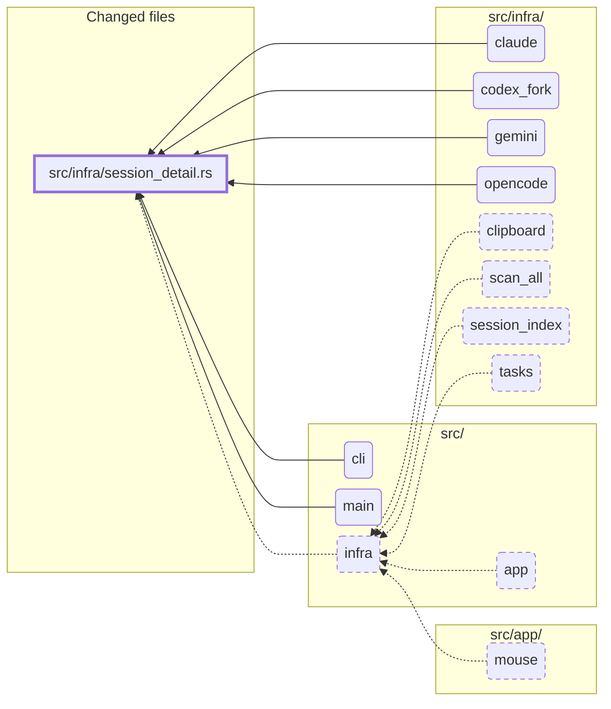

# Wingbox Pull Request Check

See what your pull request touches before you merge.

On every pull request this GitHub Action writes one comment that answers:
which modules use the files you changed, but are not part of the pull request?
Those are the places a change can break without showing up in the diff. The
comment says it in its first line:

> **Wingbox: 6 modules outside this pull request use what it changes**
>
> These modules use `src/infra/session_detail.rs`, which this pull request
> changes. They are not in the pull request, so a change in behaviour reaches
> them without showing in the diff:
>
> - `src/cli` uses `LoadSessionTimelineError`, `load_session_timeline`
> - `src/infra/claude` uses `LastAssistantOutput`
> - ...

You get:

- **The modules to look at**: each module that uses a changed file directly,
  with what it uses from it; when nothing outside the pull request uses the
  changed files, the comment is one sentence.
- **Boundary findings first**: the layer, capability and pattern violations the
  pull request introduces (the ones the base branch does not have) lead the
  comment and its heading.
- **A picture and the rest, folded**: the blast radius as a diagram, the
  modules farther away, the tests and the files outside the code graph sit
  under one "More" line, so the comment stays short.
- **What was not checked**, said as such, so that silence is never read as a
  pass.

The comment is updated on each push, so a pull request never gets a second
one. The same report goes to the job summary of the workflow run, unfolded and
with every module listed. A pull request that changes no source file outside
the tests gets no comment; the job summary says so in one line.

The action uses [Wingbox](https://github.com/aileron-tech/wingbox), an
open-source code graph that is built on the runner, and installs
wingbox 0.10.1 from PyPI.

## What the comment looks like

The picture for a one-file change in a public Rust project (the whole comment:
[examples/rust-small.md](examples/rust-small.md)):



and the comment opens with the modules to look at:

> ## Wingbox: 6 modules outside this pull request use what it changes
>
> These modules use `src/infra/session_detail.rs`, which this pull request changes. They are not in the pull request, so a change in behaviour reaches them without showing in the diff:
>
> - `src/cli` uses `LoadSessionTimelineError`, `load_session_timeline`
> - `src/infra/claude` uses `LastAssistantOutput`
> - `src/infra/codex_fork` uses `load_session_timeline`

The picture is folded under the line "More: the picture, 1 through a facade or
declaration, 6 within 2 hops".

More examples, each the text the action would post, built locally and not
posted anywhere: [a larger change in the same Rust project](examples/rust-large.md)
and [fastapi/fastapi#16746](examples/fastapi-16746.md), a Python pull request
with several hundred dependents, where the diagram collapses folders into
counted boxes.

## Usage

```yaml
name: wingbox
on: pull_request
permissions: {contents: read, pull-requests: write}
jobs:
  check:
    runs-on: ubuntu-latest
    steps:
      - uses: actions/checkout@v4
        with: {fetch-depth: 0}
      - uses: aileron-tech/wingbox-action@v1
```

`fetch-depth: 0` is needed: the action compares the head of the pull request
with its base, so the base commit must be in the checkout.

The action is a composite action (Python and git, no container), and its test
workflow runs it on `ubuntu-latest`, `macos-latest` and `windows-latest`.
Wingbox parses Python, TypeScript, Rust, C#, Java, Go, Ruby, PHP, Dart and
Free Pascal.

## Reading the comment

- **The heading and the first sentence** say how many modules outside the pull
  request use what it changes, and name the changed files they use. With new
  boundary findings the heading names them first. When no module outside the
  pull request uses a changed file directly and there is no new finding, the
  comment is one sentence.
- **New boundary findings**: findings of `wingbox boundaries` on the head that
  the base does not have. Known findings (in a baseline) and type-only imports
  are not counted. Without any, the comment says "No new boundary finding."
- **The list**: modules that import or use a changed file and are not changed
  themselves. Where Wingbox follows a name to the file that defines it, the
  row says which names (at most three, then a count). Wingbox 0.10.1 does
  this for Rust; for the other languages the row names the module (and the
  changed file, when the pull request changes several).
- **More** (folded in the comment, open in the job summary):
  - the diagram;
  - **through a module facade or declaration**: modules that reach a changed
    file only through the file that declares or re-exports it (`mod.rs`,
    `lib.rs`, `__init__.py`, an `index.ts`) without naming an item of it.
    They see the change only if it alters something they use, so they are
    counted, not listed;
  - **within N hops**: modules that depend on a direct dependent, counted by
    folder;
  - **tests** that use the changed code, counted apart;
  - the changed files that are not in the code graph.
- **Not checked**: the parts of the repository `wingbox boundaries` could not
  check (rules it cannot read, no layered style, too few files). No finding
  there is not a pass, and the comment says so.

### The diagram

GitHub draws the diagram from a `mermaid` block in the comment; no image is
uploaded and nothing is stored. An arrow points from a module to what it uses.
A thick border marks a changed file, a solid border a direct dependent, a
dashed border a module that reaches a changed file through a facade, a
declaration or within N hops. Modules are grouped by folder. Changed files
that no unchanged module uses are left out.

The diagram never has more than 40 boxes and 60 arrows. A larger blast radius
is collapsed: the farther modules of a folder become one box with their count,
then the direct ones, then the changed files; every module is still counted in
a box. If that is still too much, the largest boxes are kept and the line
under the diagram says how many modules, files and arrows are not drawn. The
same pull request always gives the same diagram.

## Inputs

| Input | Default | Meaning |
|---|---|---|
| `version` | the current wingbox release | The wingbox release installed from PyPI. The names of what a dependent uses and the paths of the farther dependents need 0.10.0 or newer. |
| `hops` | `2` | How far dependents are followed from each changed file. |
| `fail-on` | `none` | `none`; `violations`: fail when the pull request introduces a layer, capability or pattern violation; `not-checked`: fail when a part of the repository could not be checked. |
| `comment` | `true` | Write the report as a comment on the pull request. With `false` the report is only in the job summary. |
| `upload-map` | `false` | Upload the interactive 3D map Wingbox builds (`.wingbox/map.html`) as the workflow artifact `wingbox-map`. |
| `paths` | all | Glob patterns of the changed files to report on, one per line; `!pattern` leaves files out. |
| `python-version` | `3.12` | The Python that runs wingbox (3.11 or newer). |
| `base` | the base of the pull request | Base commit, for a run outside `pull_request`. |
| `head` | the head of the pull request | Head commit. |
| `working-directory` | `.` | The checkout of the repository. |
| `github-token` | `github.token` | Token for the comment. |

## Outputs

| Output | Meaning |
|---|---|
| `report` | Path of the Markdown report on the runner (the text of the job summary). |
| `map` | Path of the copy of the interactive map on the runner; empty unless `upload-map` is `true`. |
| `untouched-dependents` | Number of different modules that depend on a changed file and are not changed. |
| `introduced-findings` | Number of boundary findings the pull request introduces. |
| `not-checked-parts` | Number of parts `wingbox boundaries` could not check. |

## Permissions

```yaml
permissions:
  contents: read         # check out the code
  pull-requests: write   # write and update the comment
```

Nothing else. A pull request from a fork gets a read-only token: the action
then writes no comment, warns, and keeps the report in the job summary.

## What it never does

- **No code leaves the runner.** The code graph is built and queried on the
  runner. The action makes two kinds of network calls: `pip` installs wingbox
  from PyPI, and the GitHub API reads the comments of the pull request and
  writes one. The comment holds module names, file paths and the names of the
  items a module uses; no source lines.
- **Nothing is written to the repository.** No commit, no push, no file in
  your branch. On the runner, Wingbox writes only into `.wingbox/` of the
  checkout (it ignores itself for git), and the action writes its report and
  the copy of the map into the runner's temporary folder. The base commit is
  checked out in a temporary git worktree that is removed.
- **No image is uploaded** for the diagram: it is text in the comment.
- **No artifact unless you ask.** With `upload-map: true` the map is stored as
  a workflow artifact of your own repository. How long it is kept is your
  setting (the artifact retention of the repository or organization); the
  action does not set one.

## Limits

- The graph is static: it holds the imports and uses Wingbox resolves in the
  source. A dependency made at run time (reflection, an import built from a
  string) is not in it.
- Names of what a dependent uses are given where Wingbox records them (Rust in
  0.10.1). Elsewhere the list names the file.
- The diagram is capped at 40 boxes and 60 arrows, as described above; the
  list in the comment names at most ten direct dependents and the job summary
  lists them all.
- GitHub refuses a comment over 65,536 characters. A longer report is cut at a
  line, never inside the diagram, and says that the whole report is in the job
  summary.
- GitHub draws the diagram on its pages; in a notification e-mail it appears
  as text.
- The artifact name `wingbox-map` can be used once per workflow run: in a
  matrix, set `upload-map` in one job.
- Two pushes in quick succession start two runs; add a `concurrency` group to
  the workflow if you want the older run cancelled.
- The code graph is built twice in each run, once for the head and once for
  the base.

## Development

```bash
python -m unittest discover -s tests          # the report, the diagram, the facts, the metadata
python tests/make_fixture.py /tmp/fixture     # a repository with a base and a head commit
python tools/replay.py CLONE BASE HEAD --out DIR   # the comment for a past pull request, locally
python scripts/bump_version.py 0.10.1         # the default wingbox release (no argument: the newest on PyPI)
```

With wingbox installed in the Python that runs the tests, they also run the
whole script on the fixture repository. The workflow in
`.github/workflows/test.yml` runs the unit tests and the action itself on the
fixture repository on Linux, macOS and Windows.

`wingbox_pr.py` is the I/O (git, the wingbox commands, the GitHub API);
`wingbox_facts.py` reads the facts Wingbox prints, `wingbox_report.py` builds
the report and `wingbox_diagram.py` the diagram, all three pure functions.

## License

MIT, see [LICENSE](LICENSE).
