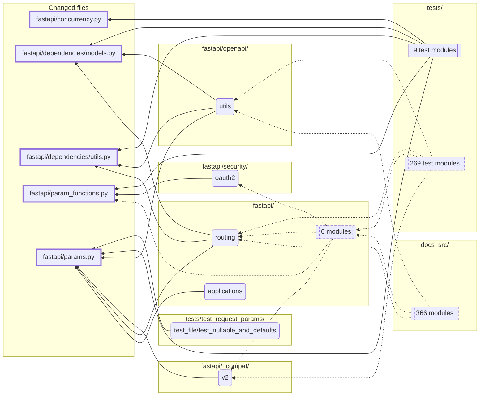

<!-- Wingbox Pull Request Check on fastapi/fastapi#16746 ("Add dependency concurrency limits with Depends(max_concurrency=...)"), base 5758a9c, head fc07dde, built locally with wingbox 0.10.1 and tools/replay.py; not posted anywhere. -->

## Wingbox: 6 changed items are used by 64 modules outside this pull request

`Depends` (function, `fastapi/param_functions.py:2391`) changed. These modules use it and are not in the pull request:

- `docs_src/authentication_error_status_code/tutorial001` calls it at `docs_src/authentication_error_status_code/tutorial001.py:16` and in 1 more place
- `docs_src/background_tasks/tutorial002` calls it at `docs_src/background_tasks/tutorial002.py:22` and in 1 more place
- `docs_src/background_tasks/tutorial002_non_an` calls it at `docs_src/background_tasks/tutorial002_non_an.py:20` and in 1 more place
- `docs_src/bigger_applications/app/main` calls it at `docs_src/bigger_applications/app/main.py:7` and in 2 more places
- `docs_src/bigger_applications/app/routers/items` calls it at `docs_src/bigger_applications/app/routers/items.py:8` and in 1 more place
- `docs_src/dependencies/tutorial001` calls it at `docs_src/dependencies/tutorial001.py:13` and in 2 more places
- `docs_src/dependencies/tutorial001_02` calls it at `docs_src/dependencies/tutorial001_02.py:12` and in 1 more place
- `docs_src/dependencies/tutorial001_non_an` calls it at `docs_src/dependencies/tutorial001_non_an.py:11` and in 2 more places
- `docs_src/dependencies/tutorial002` calls it at `docs_src/dependencies/tutorial002.py:19` and in 1 more place
- `docs_src/dependencies/tutorial002_non_an` calls it at `docs_src/dependencies/tutorial002_non_an.py:17` and in 1 more place
- ... and 51 more, by folder: `docs_src/dependencies/` 24, `docs_src/security/` 14, `docs_src/settings/` 4, `docs_src/sql_databases/` 4, `docs_src/dependency_testing/` 2, `docs_src/websockets_/` 2, 1 more folder(s) (the job summary lists them all)

85 test modules use it too.

`Dependant` (type, `fastapi/dependencies/models.py:36`) changed. These modules use it and are not in the pull request:

- `fastapi/openapi/utils` uses it as a type at `fastapi/openapi/utils.py:94` and in 4 more places
- `fastapi/routing` uses it as a type at `fastapi/routing.py:364` and in 8 more places

1 test module uses it too.

`Depends` (type, `fastapi/params.py:792`) changed. These modules use it and are not in the pull request:

- `fastapi/applications` uses it as a type at `fastapi/applications.py:355` and in 14 more places
- `fastapi/routing` uses it as a type at `fastapi/routing.py:861` and in 23 more places

`get_parameterless_sub_dependant` (function, `fastapi/dependencies/utils.py:148`) changed. This module uses it and is not in the pull request:

- `fastapi/routing` calls it at `fastapi/routing.py:918` and in 1 more place

`get_dependant` (function, `fastapi/dependencies/utils.py:305`) changed. This module uses it and is not in the pull request:

- `fastapi/routing` calls it at `fastapi/routing.py:914` and in 1 more place

... and 1 more changed items that other modules use (the job summary lists them all).

Other code of `fastapi/dependencies/models.py`, `fastapi/dependencies/utils.py` and 1 more changed too, outside the items Wingbox lists. These modules use those files and are not in the pull request:

- `fastapi/_compat/v2` uses `fastapi/params.py`
- `fastapi/applications` uses `fastapi/params.py`
- `fastapi/openapi/utils` uses `fastapi/dependencies/models.py`, `fastapi/dependencies/utils.py` and 1 more
- `fastapi/routing` uses `fastapi/dependencies/models.py`, `fastapi/dependencies/utils.py` and 1 more

More: the picture, 1 module that uses the changed files but not what changed, 1 through a facade or declaration, 371 within 2 hops, 279 test modules, 3 files outside the code graph

### Blast radius

An arrow points from a module to what it uses. Thick border: changed in this pull request. Dashed: it reaches a changed file through a module facade, a declaration or within 2 hops. A box with a count stands for the modules of one folder.

Use the changed files but not the items that changed: 1 module(s), by folder: `fastapi/security/` 1.

Through `fastapi/param_functions.py` (a module facade or the declaration of the file): 1 module(s), by folder: `fastapi/` 1. They see the change only if it alters an item they use.

Within 2 hops, by folder: `docs_src/query_params_str_validations/` 30, `docs_src/dependencies/` 29, `docs_src/custom_response/` 15, `docs_src/request_form_models/` 14, `docs_src/security/` 14, `docs_src/path_params_numeric_validations/` 12, 75 more folder(s).

Tests that use the changed code (279), by folder: `tests/` 217, `tests/test_request_params/` 31, `tests/test_telemetry/` 12, `tests/test_tutorial/` 11, `tests/test_modules_same_name_body/` 3, `tests/benchmarks/` 2, 2 more folder(s).

Not in the code graph (3: documents, configuration or deleted files): `docs/en/docs/advanced/advanced-dependencies.md`, `fastapi/.agents/skills/fastapi/SKILL.md`, `fastapi/.agents/skills/fastapi/references/dependencies.md`.

No new boundary finding.

**Not checked**: part `.` (its style has no layers). No finding is reported there, and that is not a pass.

[Wingbox](https://wingbox.dev) 0.10.2, base `5758a9c`, head `fc07dde`. Built and checked on the runner, without a language model; no code left it.
