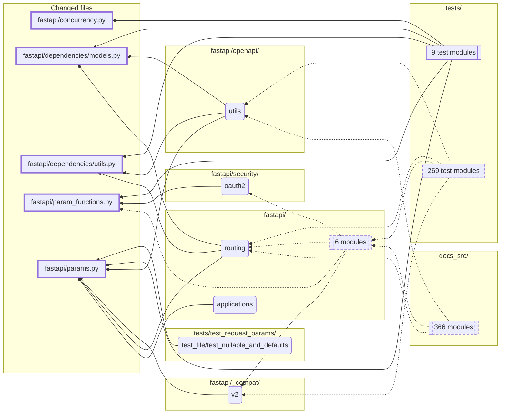

<!-- Wingbox Pull Request Check on fastapi/fastapi#16746 ("Add dependency concurrency limits with Depends(max_concurrency=...)"), base 5758a9c, head fc07dde, built locally with wingbox 0.10.1 and tools/replay.py; not posted anywhere. -->

## Wingbox: what this pull request touches

**5** module(s) not changed by this pull request use a changed file directly; 1 more through a module facade or declaration; 371 within 2 hops; 279 test module(s). **0** new boundary finding(s). 9 changed file(s), 6 in the code graph.

### Blast radius

An arrow points from a module to what it uses. Thick border: changed in this pull request. Dashed: it reaches a changed file through a module facade, a declaration or within 2 hops. A box with a count stands for the modules of one folder.

### Not changed, but uses what changed

Directly:

- `fastapi/_compat/v2` uses `fastapi/params.py`
- `fastapi/applications` uses `fastapi/params.py`
- `fastapi/openapi/utils` uses `fastapi/dependencies/models.py`, `fastapi/dependencies/utils.py` and 1 more
- `fastapi/routing` uses `fastapi/dependencies/models.py`, `fastapi/dependencies/utils.py` and 1 more
- `fastapi/security/oauth2` uses `fastapi/param_functions.py`

Through `fastapi/param_functions.py` (a module facade or the declaration of the file): 1 module(s), by folder: `fastapi/` 1. They see the change only if it alters an item they use.

Within 2 hops, by folder: `docs_src/query_params_str_validations/` 30, `docs_src/dependencies/` 29, `docs_src/custom_response/` 15, `docs_src/request_form_models/` 14, `docs_src/security/` 14, `docs_src/path_params_numeric_validations/` 12, 75 more folder(s).

Tests that use the changed code (279), by folder: `tests/` 217, `tests/test_request_params/` 31, `tests/test_telemetry/` 12, `tests/test_tutorial/` 11, `tests/test_modules_same_name_body/` 3, `tests/benchmarks/` 2, 2 more folder(s).

Not in the code graph (3: documents, configuration or deleted files): `docs/en/docs/advanced/advanced-dependencies.md`, `fastapi/.agents/skills/fastapi/SKILL.md`, `fastapi/.agents/skills/fastapi/references/dependencies.md`.

### Boundary findings introduced by this pull request

None.

**Not checked**: part `.` (its style has no layers). No finding is reported there, and that is not a pass.

Wingbox 0.10.1, base `5758a9c`, head `fc07dde`. Built and checked on the runner; no code left it.
