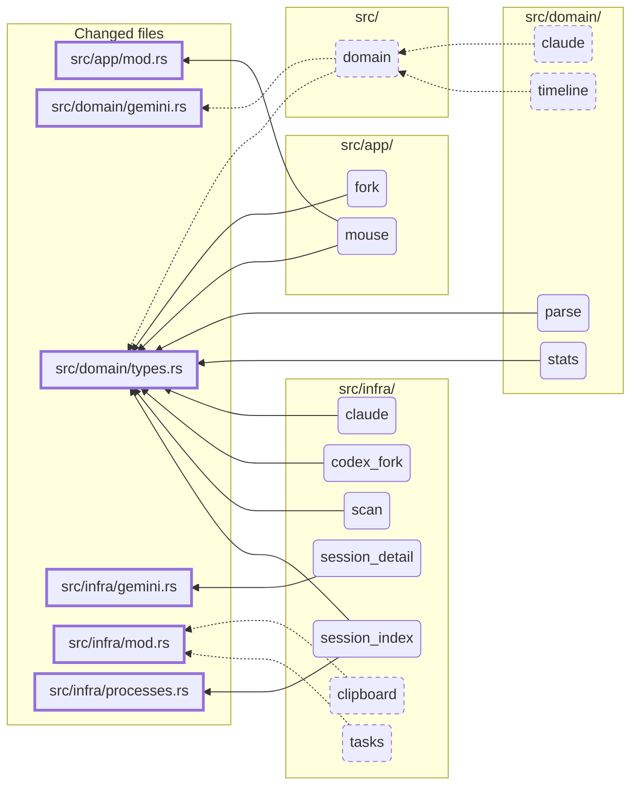

<!-- Wingbox Pull Request Check on a fifteen-file commit of a public Rust project, replayed as a pull request against its parent, built locally with wingbox 0.10.1 and tools/replay.py; not posted anywhere. -->

## Wingbox: 5 items touched by this change are used by 7 modules outside this pull request

`SessionEngine` (enum, `src/domain/types.rs:27`) changed. These modules use it and are not in the pull request:

- `src/app/fork` uses it at `src/app/fork.rs:71` and in 1 more place
- `src/domain/parse` uses it as a type at `src/domain/parse.rs:166` and in 2 more places
- `src/infra/claude` uses it at `src/infra/claude.rs:320` and in 2 more places
- `src/infra/scan` uses it at `src/infra/scan.rs:158` and in 1 more place
- `src/infra/session_index` uses it at `src/infra/session_index.rs:111` and in 1 more place

`AppModel` (type, `src/app/mod.rs:77`) changed. This module uses it and is not in the pull request:

- `src/app/mouse` uses it as a type at `src/app/mouse.rs:8` and in 12 more places

`AppCommand` (enum, `src/app/mod.rs:1763`) changed. This module uses it and is not in the pull request:

- `src/app/mouse` uses it as a type at `src/app/mouse.rs:8` and in 4 more places

`update` (function, `src/app/mod.rs:1856`) calls `update_on_key`, which changed. This module uses it and is not in the pull request:

- `src/app/mouse` calls it at `src/app/mouse.rs:653` and in 2 more places

`load_gemini_session_timeline` (function, `src/infra/gemini.rs:302`) changed. This module uses it and is not in the pull request:

- `src/infra/session_detail` calls it at `src/infra/session_detail.rs:108`

Other code of `src/app/mod.rs`, `src/infra/gemini.rs` and 1 more changed too, outside the items Wingbox lists. These modules use those files and are not in the pull request:

- `src/app/mouse` uses `AppCommand`, `AppData`, `AppEvent` and 11 more from `src/app/mod.rs`
- `src/infra/session_detail` uses `is_gemini_session_path`, `load_gemini_last_assistant_output`, `load_gemini_session_timeline` from `src/infra/gemini.rs`
- `src/infra/session_index` uses `read_tail` from `src/infra/processes.rs`

More: the picture, 2 modules that use the changed files but not what changed, 3 through a facade or declaration, 2 within 2 hops, 2 files outside the code graph

### Blast radius

An arrow points from a module to what it uses. Thick border: changed in this pull request. Dashed: it reaches a changed file through a module facade, a declaration or within 2 hops.

Use the changed files but not the items that changed: 2 module(s), by folder: `src/domain/` 1, `src/infra/` 1.

Through `src/domain/gemini.rs`, `src/domain/types.rs` and 1 more (a module facade or the declaration of the file): 3 module(s), by folder: `src/infra/` 2, `src/` 1. They see the change only if it alters an item they use.

Within 2 hops, by folder: `src/domain/` 2.

Not in the code graph (2: documents, configuration or deleted files): `CHANGELOG.md`, `README.md`.

No new boundary finding.

**Not checked**: part `.` (its style has no layers). No finding is reported there, and that is not a pass.

[Wingbox](https://wingbox.dev) 0.10.2, base `a34c249`, head `8543fd1`. Built and checked on the runner, without a language model; no code left it.
