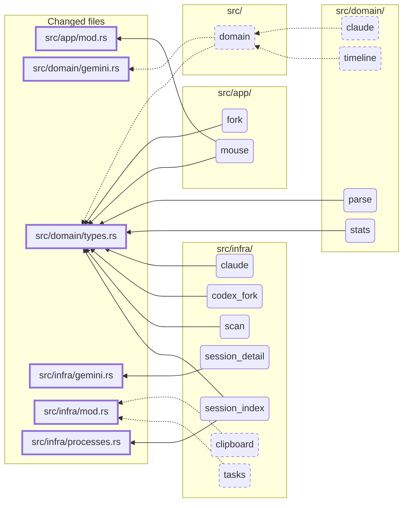

<!-- Wingbox Pull Request Check on a fifteen-file commit of a public Rust project, replayed as a pull request against its parent, built locally with wingbox 0.10.1 and tools/replay.py; not posted anywhere. -->

## Wingbox: 9 modules outside this pull request use what it changes

These modules use `src/app/mod.rs`, `src/domain/types.rs` and 2 more, which this pull request changes. They are not in the pull request, so a change in behaviour reaches them without showing in the diff:

- `src/app/fork` uses `ForkContext`, `ForkCut`, `SessionEngine` and 2 more from `src/domain/types.rs`
- `src/app/mouse` uses `AppCommand`, `AppData`, `AppEvent` and 11 more from `src/app/mod.rs`; `ProjectSummary` from `src/domain/types.rs`
- `src/domain/parse` uses `ProjectSummary`, `SessionEngine`, `SessionMeta` and 1 more from `src/domain/types.rs`
- `src/domain/stats` uses `SessionMeta` from `src/domain/types.rs`
- `src/infra/claude` uses `SessionEngine`, `SessionMeta`, `SessionSummary` from `src/domain/types.rs`
- `src/infra/codex_fork` uses `ForkCut` from `src/domain/types.rs`
- `src/infra/scan` uses `SessionEngine`, `SessionSummary` from `src/domain/types.rs`
- `src/infra/session_detail` uses `is_gemini_session_path`, `load_gemini_last_assistant_output`, `load_gemini_session_timeline` from `src/infra/gemini.rs`
- `src/infra/session_index` uses `SessionEngine`, `SessionSummary` from `src/domain/types.rs`; `read_tail` from `src/infra/processes.rs`

More: the picture, 3 through a facade or declaration, 2 within 2 hops, 2 files outside the code graph

### Blast radius

An arrow points from a module to what it uses. Thick border: changed in this pull request. Dashed: it reaches a changed file through a module facade, a declaration or within 2 hops.

Through `src/domain/gemini.rs`, `src/domain/types.rs` and 1 more (a module facade or the declaration of the file): 3 module(s), by folder: `src/infra/` 2, `src/` 1. They see the change only if it alters an item they use.

Within 2 hops, by folder: `src/domain/` 2.

Not in the code graph (2: documents, configuration or deleted files): `CHANGELOG.md`, `README.md`.

No new boundary finding.

**Not checked**: part `.` (its style has no layers). No finding is reported there, and that is not a pass.

Wingbox 0.10.1, base `a34c249`, head `8543fd1`. Built and checked on the runner; no code left it.
