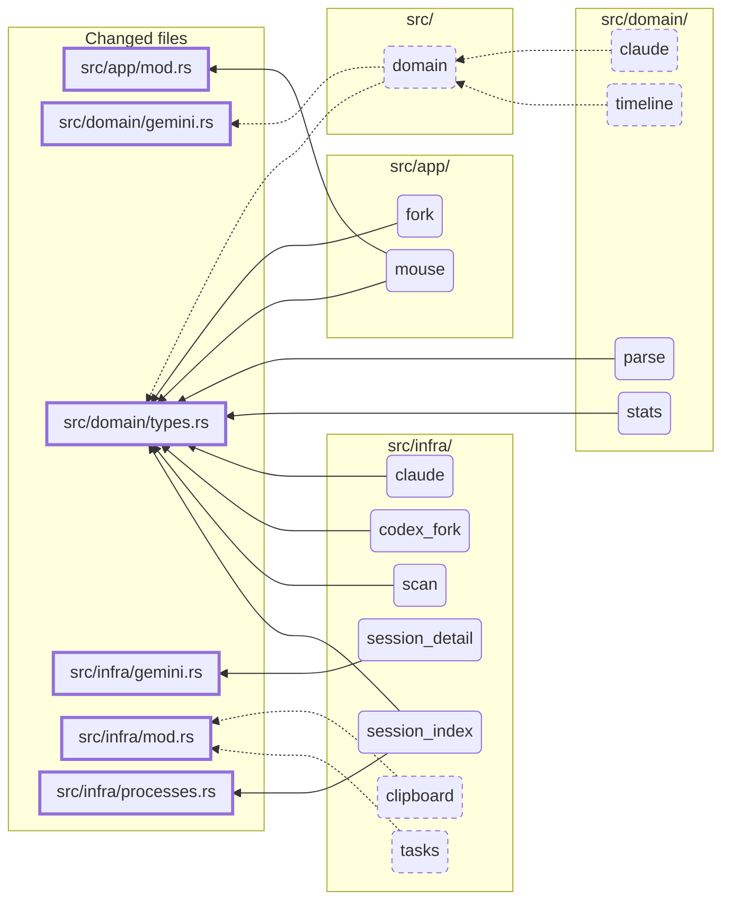

<!-- Wingbox Pull Request Check on a fifteen-file commit of a public Rust project, replayed as a pull request against its parent, built locally with wingbox 0.11.0 and tools/replay.py; not posted anywhere. -->

## Wingbox: 5 items touched by this change are used by 7 modules outside this pull request

`SessionEngine` (enum, `src/domain/types.rs:27`) changed. These modules use it and are not in the pull request:

- `src/app/fork` uses it at `src/app/fork.rs:71` and in 1 more place
- `src/domain/parse` uses it as a type at `src/domain/parse.rs:166` and in 2 more places
- `src/infra/claude` uses it at `src/infra/claude.rs:320` and in 2 more places
- `src/infra/scan` uses it at `src/infra/scan.rs:158` and in 1 more place
- `src/infra/session_index` uses it at `src/infra/session_index.rs:111` and in 1 more place

`AppModel` (type, `src/app/mod.rs:77`) changed. This module uses it and is not in the pull request:

- `src/app/mouse` uses it as a type at `src/app/mouse.rs:8` and in 12 more places

`AppCommand` (enum, `src/app/mod.rs:1763`) changed. This module uses it and is not in the pull request:

- `src/app/mouse` uses it as a type at `src/app/mouse.rs:8` and in 4 more places

`update` (function, `src/app/mod.rs:1856`) calls `update_on_key`, which changed. This module uses it and is not in the pull request:

- `src/app/mouse` calls it at `src/app/mouse.rs:653` and in 2 more places

`load_gemini_session_timeline` (function, `src/infra/gemini.rs:302`) changed. This module uses it and is not in the pull request:

- `src/infra/session_detail` calls it at `src/infra/session_detail.rs:108`

Other code of `src/app/mod.rs`, `src/infra/gemini.rs` and 1 more changed too, outside the items Wingbox lists. These modules use those files and are not in the pull request:

- `src/app/mouse` uses `AppCommand`, `AppData`, `AppEvent` and 11 more from `src/app/mod.rs`
- `src/infra/session_detail` uses `is_gemini_session_path`, `load_gemini_last_assistant_output`, `load_gemini_session_timeline` from `src/infra/gemini.rs`
- `src/infra/session_index` uses `read_tail` from `src/infra/processes.rs`

<details>
<summary>More: the picture, 2 modules that use the changed files but not what changed, 3 through a facade or declaration, 2 within 2 hops, 2 files outside the code graph</summary>

### Blast radius



<sub>An arrow points from a module to what it uses. Thick border: changed in this pull request. Dashed: it reaches a changed file through a module facade, a declaration or within 2 hops.</sub>

Use the changed files but not the items that changed: 2 module(s), by folder: `src/domain/` 1, `src/infra/` 1.

Through `src/domain/gemini.rs`, `src/domain/types.rs` and 1 more (a module facade or the declaration of the file): 3 module(s), by folder: `src/infra/` 2, `src/` 1. They see the change only if it alters an item they use.

Within 2 hops, by folder: `src/domain/` 2.

Not in the code graph (2: documents, configuration or deleted files): `CHANGELOG.md`, `README.md`.

</details>

No new boundary finding.

**Not checked**: part `.` (its style has no layers). No finding is reported there, and that is not a pass. No part of this repository could be checked against boundary rules.

<details>
<summary>Review plan for an agent</summary>

```lisp
(review-plan :schema 1 :result UNKNOWN :execution ok :base a34c249 :head 8543fd1 :wingbox "0.11.0" :hops 2)
(reason "not-checked: . (no-layer-style)")
(changed-item "src/domain/types.rs" SessionEngine :kind enm :line 27 :how changed)
(look "src/app/fork.rs" 71 :module src/app/fork :why reference :item SessionEngine :places 2)
(look "src/domain/parse.rs" 166 :module src/domain/parse :why type :item SessionEngine :places 3)
(look "src/infra/claude.rs" 320 :module src/infra/claude :why reference :item SessionEngine :places 3)
(look "src/infra/scan.rs" 158 :module src/infra/scan :why reference :item SessionEngine :places 2)
(look "src/infra/session_index.rs" 111 :module src/infra/session_index :why reference :item SessionEngine :places 2)
(changed-item "src/app/mod.rs" AppModel :kind cls :line 77 :how changed)
(look "src/app/mouse.rs" 8 :module src/app/mouse :why type :item AppModel :places 13)
(changed-item "src/app/mod.rs" AppCommand :kind enm :line 1763 :how changed)
(look "src/app/mouse.rs" 8 :module src/app/mouse :why type :item AppCommand :places 5)
(changed-item "src/app/mod.rs" update :kind fn :line 1856 :how calls :via (update_on_key))
(look "src/app/mouse.rs" 653 :module src/app/mouse :why call :item update :places 3)
(changed-item "src/infra/gemini.rs" load_gemini_session_timeline :kind fn :line 302 :how changed)
(look "src/infra/session_detail.rs" 108 :module src/infra/session_detail :why call :item load_gemini_session_timeline :places 1)
(other-code "src/app/mod.rs")
(other-code "src/infra/gemini.rs")
(other-code "src/infra/mod.rs")
(whole-file "src/infra/opencode.rs")
(whole-file "src/infra/processes.rs")
(whole-file "src/infra/scan_all.rs")
(whole-file "src/infra/session_aliases.rs")
(whole-file "src/infra/session_projects.rs")
(whole-file "src/main.rs")
(whole-file "src/ui/mod.rs")
(look-module src/app/mouse :why uses :file "src/app/mod.rs")
(look-module src/infra/session_detail :why uses :file "src/infra/gemini.rs")
(look-module src/infra/session_index :why uses :file "src/infra/processes.rs")
(not-checked "." :reason no-layer-style)
(checked :modules 0)
(changed-file "CHANGELOG.md" :sha256 f55f8754b690f1630b90e9a5b3fe424aaa34c54c1daa8b8a37b2ca91e859ad8b)
(changed-file "README.md" :sha256 f0103694d6891023343bd326c64a61799ce3b1e0fc2cc266ecf6040455b35e3f)
(changed-file "src/app/mod.rs" :sha256 d31b517a3ebcc7c0c0f5bdbb4e0bb11d95567477d2d21b5b45a081fc9bc05e8b)
(changed-file "src/cli/mod.rs" :sha256 9f55d0798b91d7eb2b5901480e8b3f88dd3e08cec60b883d65507928081466aa)
(changed-file "src/domain/gemini.rs" :sha256 4cd7637f6ef2e6d3d2fe80685ea1b4c295101faf2a379a5c1168fbe7f93486d3)
(changed-file "src/domain/types.rs" :sha256 45175698b18af0c01f2dcec994885d15c8258513d678d82d69768fa3b2c19605)
(changed-file "src/infra/gemini.rs" :sha256 174aa006e9be34efb6ab65e32c2aaeb7a9fa4b19e8cff54e65f6e4702527f5c6)
(changed-file "src/infra/mod.rs" :sha256 18f58d80661306843fb41124502d26b4f92128fb4239c5d659accc3d00a2fad4)
(changed-file "src/infra/opencode.rs" :sha256 a3ca2c3aa323552fd9b6cd5c21b03f7f05dfc7ae811ae77f5959a5eb5aa369ed)
(changed-file "src/infra/processes.rs" :sha256 f6c60a774f7c3978873c2d316e9c290031ff873432edc63d8b4f0e31fe3664ec)
(changed-file "src/infra/scan_all.rs" :sha256 5dccb4b30ebd046a27ac0dbb01c3d5e78df3b8a734fc994e5905374cb0e446d8)
(changed-file "src/infra/session_aliases.rs" :sha256 2909221206b1388ebb11ed4df3ed21887bf0b1846b9d66022209f349a8a4f1e3)
(changed-file "src/infra/session_projects.rs" :sha256 c4fa8e73bd8e66236cc22ebfa8b9c9cd8f87716bc354c9a38e282e8c190bd96c)
(changed-file "src/main.rs" :sha256 c829cff9d8d89fedbd2b9a2b16519099897126e48e7e12df436df43d34ea0e2f)
(changed-file "src/ui/mod.rs" :sha256 daf9bbcf14f61ee38e441357bdf3d69cab19d157176105c9e4f10fd2b2f275f5)
```

</details>

<sub>[Wingbox](https://wingbox.dev) 0.11.0, base `a34c249`, head `8543fd1`. Built and checked on the runner, without a language model; no code left it.</sub>
