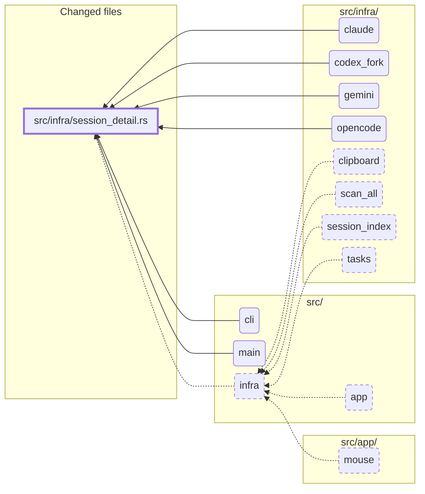

<!-- Wingbox Pull Request Check on a one-file commit of a public Rust project, replayed as a pull request against its parent, built locally with wingbox 0.10.1 and tools/replay.py; not posted anywhere. -->

## Wingbox: 2 items touched by this change are used by 4 modules outside this pull request

`load_session_timeline` (function, `src/infra/session_detail.rs:97`) calls `detect_log_format`, which calls `looks_like_claude_jsonl`, which changed. These modules use it and are not in the pull request:

- `src/cli` calls it at `src/cli/mod.rs:331` and in 1 more place
- `src/infra/codex_fork` calls it at `src/infra/codex_fork.rs:375` and in 1 more place
- `src/infra/opencode` calls it at `src/infra/opencode.rs:992`
- `src/main` calls it at `src/main.rs:426` and in 4 more places

`load_last_assistant_output` (function, `src/infra/session_detail.rs:30`) calls `detect_log_format`, which calls `looks_like_claude_jsonl`, which changed. This module uses it and is not in the pull request:

- `src/main` calls it at `src/main.rs:1093` and in 1 more place

More: the picture, 2 modules that use the changed files but not what changed, 1 through a facade or declaration, 6 within 2 hops

### Blast radius

An arrow points from a module to what it uses. Thick border: changed in this pull request. Dashed: it reaches a changed file through a module facade, a declaration or within 2 hops.

Use the changed files but not the items that changed: 2 module(s), by folder: `src/infra/` 2.

Through `src/infra/session_detail.rs` (a module facade or the declaration of the file): 1 module(s), by folder: `src/` 1. They see the change only if it alters an item they use.

Within 2 hops, by folder: `src/infra/` 4, `src/` 1, `src/app/` 1.

No new boundary finding.

**Not checked**: part `.` (its style has no layers). No finding is reported there, and that is not a pass.

[Wingbox](https://wingbox.dev) 0.10.2, base `70939f6`, head `cf6d8c8`. Built and checked on the runner, without a language model; no code left it.
