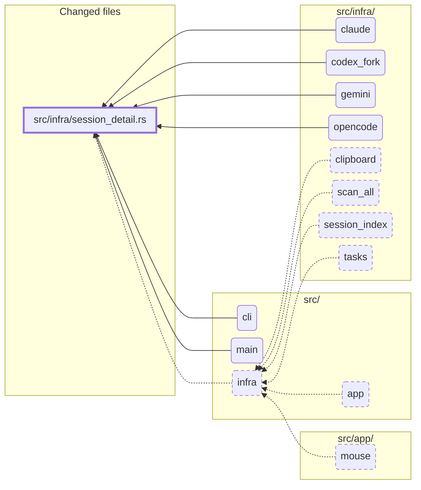

<!-- Wingbox Pull Request Check on a one-file commit of a public Rust project, replayed as a pull request against its parent, built locally with wingbox 0.10.1 and tools/replay.py; not posted anywhere. -->

## Wingbox: 6 modules outside this pull request use what it changes

These modules use `src/infra/session_detail.rs`, which this pull request changes. They are not in the pull request, so a change in behaviour reaches them without showing in the diff:

- `src/cli` uses `LoadSessionTimelineError`, `load_session_timeline`
- `src/infra/claude` uses `LastAssistantOutput`
- `src/infra/codex_fork` uses `load_session_timeline`
- `src/infra/gemini` uses `LastAssistantOutput`
- `src/infra/opencode` uses `load_session_timeline`
- `src/main` uses `load_last_assistant_output`, `load_session_timeline`

More: the picture, 1 through a facade or declaration, 6 within 2 hops

### Blast radius

An arrow points from a module to what it uses. Thick border: changed in this pull request. Dashed: it reaches a changed file through a module facade, a declaration or within 2 hops.

Through `src/infra/session_detail.rs` (a module facade or the declaration of the file): 1 module(s), by folder: `src/` 1. They see the change only if it alters an item they use.

Within 2 hops, by folder: `src/infra/` 4, `src/` 1, `src/app/` 1.

No new boundary finding.

**Not checked**: part `.` (its style has no layers). No finding is reported there, and that is not a pass.

Wingbox 0.10.1, base `70939f6`, head `cf6d8c8`. Built and checked on the runner; no code left it.
